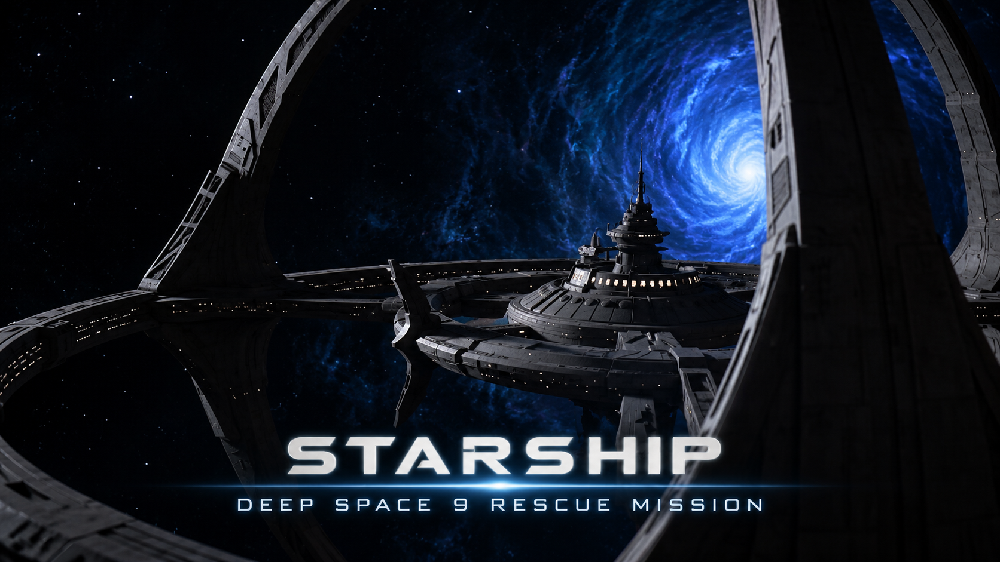

# Starship: eine Rettungsmission in fünf Akten

> Sternzeit 49011.4. Deep Space 9 kreist am Rand des Bajoranischen Systems, direkt vor dem Wurmloch, und ist der wichtigste Umschlagplatz des Quadranten.
> Jeden Tag docken Frachter an, laden Antimaterie und brechen zu den Kolonien auf, und Commander Sisko hält die Station mit seiner Crew am Laufen.
> Heute beginnt eine neue Versorgungsroute: Die Kolonien auf Bajor brauchen Hilfsgüter, und drei Schiffe stehen dafür bereit.
> Der Frachter Xhosa von Kasidy Yates soll als Erster auslaufen, mit 80 Tonnen an Bord und einem Kurs, der drei Warp-Sprünge weit ins Leere führt.
> Niemand ahnt, dass sein Warpkern seit der letzten Wartung zu heiß läuft.
> Nach dem dritten Sprung ist es so weit: Ein Alarm heult durch das Schiff, und die Xhosa treibt manövrierunfähig im All.
> Kasidy hat nur noch eine Chance, und das ist ein Notruf an alle Schiffe in Reichweite.
> In Quarks Bar sitzt die Crew des Rettungsschiffs Rio Grande gerade beim Raktajino, als der Alarm über jeden Schirm läuft.
> Ob die Rettung gelingt, hängt an den Regeln dieser kleinen Welt, und diese Regeln programmiert ihr.

## Die Besetzung

**Die Schiffe**
- **Deep Space 9**: die Raumstation, Heimathafen bei (100,200)
- **Xhosa**: Frachter, 100 Tonnen, das Schiff von Kasidy Yates
- **Bok'Nor**: Frachter, 60 Tonnen, bleibt im Dock
- **Rio Grande**: das Rettungsschiff der Station

**Die Leute**
- **Sisko**: Kommandant der Station, trifft die Entscheidungen
- **Kira**: Captain der Xhosa
- **Nog**: Pilot der Xhosa
- **Worf**: Captain der Rio Grande
- **Dax**: Pilotin der Rio Grande
- **Bashir**: Arzt, Medic der Rio Grande
- **O'Brien** und **Rom**: Ingenieure, warten im Pool
- **Jabara**: Krankenschwester, zweiter Medic im Pool
- **Kasidy Yates**: Frachterkapitänin, fliegt mit der Xhosa, gehört nicht zur Sternenflotte
- **Quark**: Barbesitzer auf der Promenade

## Akt 0: Deep Space 9 wird gebaut

### 0.1 Projekt Setup

Bevor es losgeht, die Hintergründe: Warum Schichten, was ist eine Solution, was ein Projekt.

📖 Nachlesen: [Warum Software Architecture (Design)?](starship-technical-background.md#1-warum-software-architecture-design), [Separation of Concerns](starship-technical-background.md#2-separation-of-concerns), [Cohesion und Coupling](starship-technical-background.md#3-cohesion-und-coupling), [Benefits of Good Architecture (Design)](starship-technical-background.md#4-benefits-of-good-architecture-design), [Unsere Separation of Concerns](starship-technical-background.md#5-unsere-separation-of-concerns), [C# Projekte und Solution](starship-technical-background.md#6-c-projekte-und-solution)

#### Schritt für Schritt in Rider

Die Tastenkürzel stehen für Mac, Windows in Klammern: `⌘` ist `Ctrl`, `⌥` ist `Alt`.

1. `File > New Solution…`, Typ **Empty Solution**, Name `StarShip`, Häkchen **Create Git repository**.

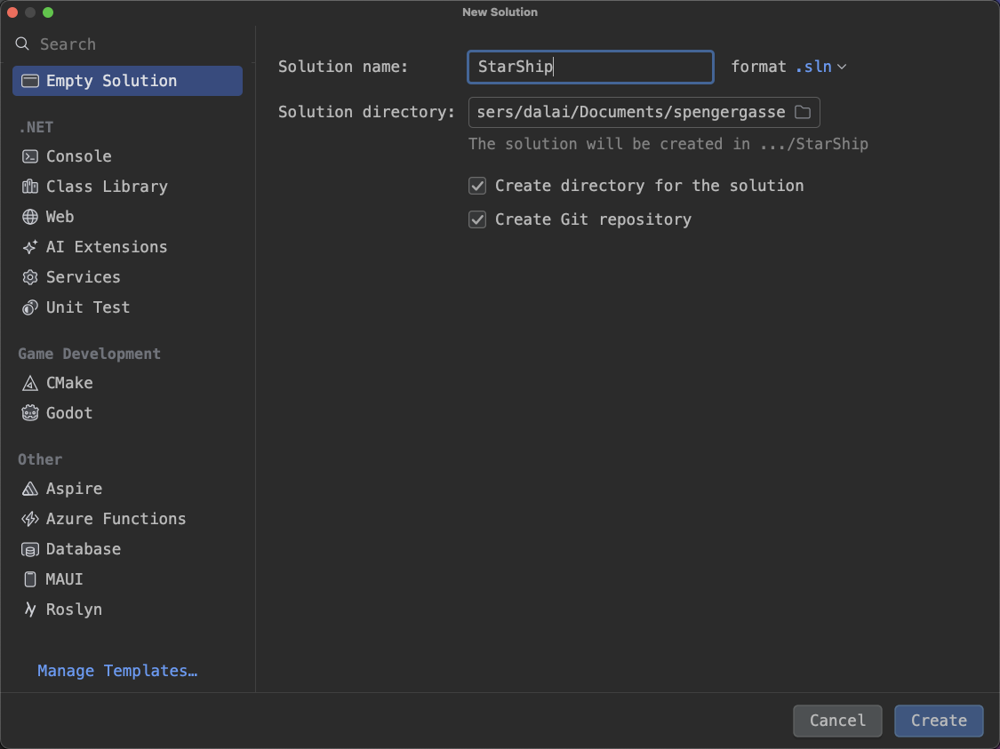

2. Rider hat eine `.gitignore` angelegt, sie sagt Git, was nicht ins Repo gehört: `bin/`, `obj/` und drei Rider Einträge.
   Drei Zeilen fehlen noch, hängt sie an: `.idea/` (Rider Einstellungen), `*.DotSettings.user` (persönliche Rider Einstellungen zur Solution) und `.DS_Store` (Mac Finder).

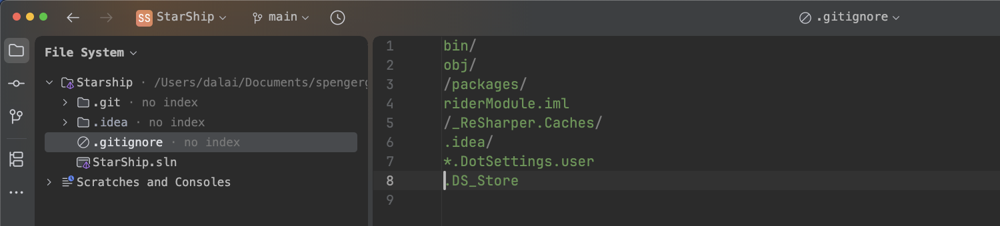

3. `⌘K` (Windows `Ctrl+K`), erster Commit: `chore: initial commit`.

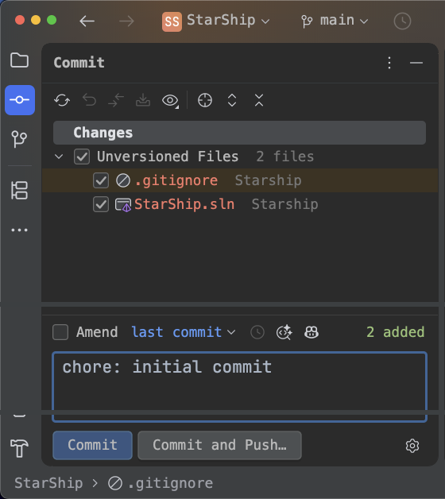

4. Rechtsklick auf die Solution, `Add > New Project…`, **Class Library** `StarShip.Domain`, Framework `net10.0`.

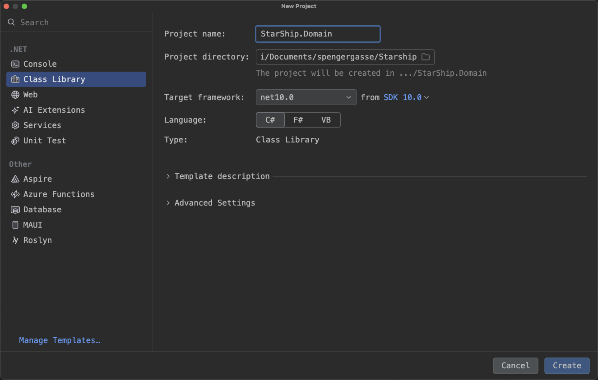

5. Dasselbe mit **Console Application** `StarShip.App`.

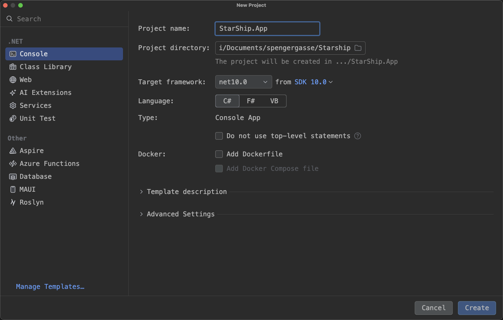

6. Dasselbe mit **Unit Test Project** `StarShip.Tests`, Framework xUnit.

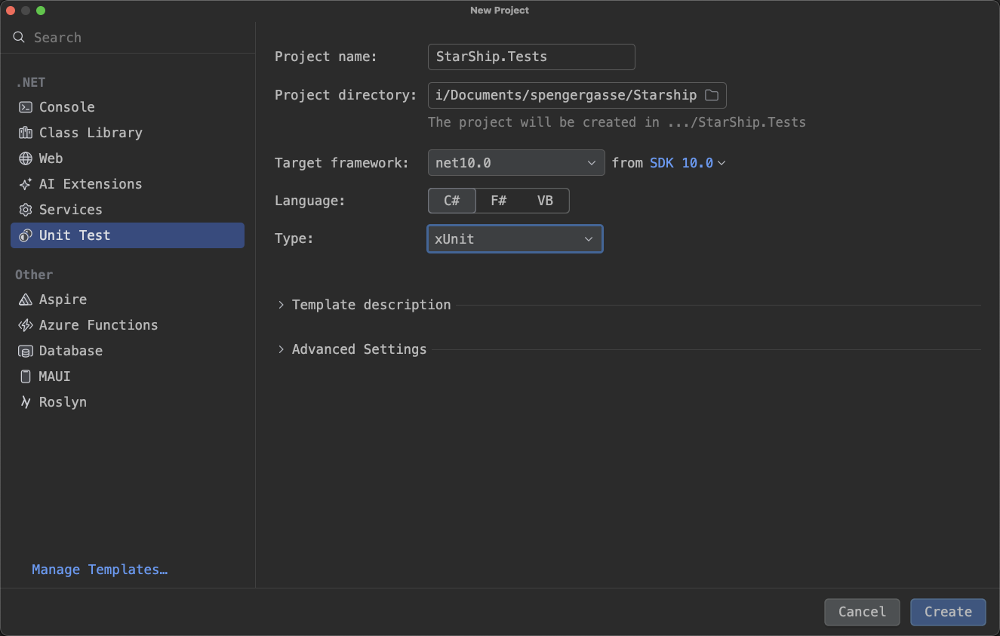

7. Rechtsklick `StarShip.App`, `Add > Reference…`, Häkchen bei `StarShip.Domain`. Dasselbe für `StarShip.Tests`.
   Erst mit der Referenz kann ein Projekt die Klassen des anderen benutzen: `using StarShip.Domain.Models;` in `Program.cs` und in den Tests.
   App und Tests kennen die Domäne, die Domäne kennt niemanden.

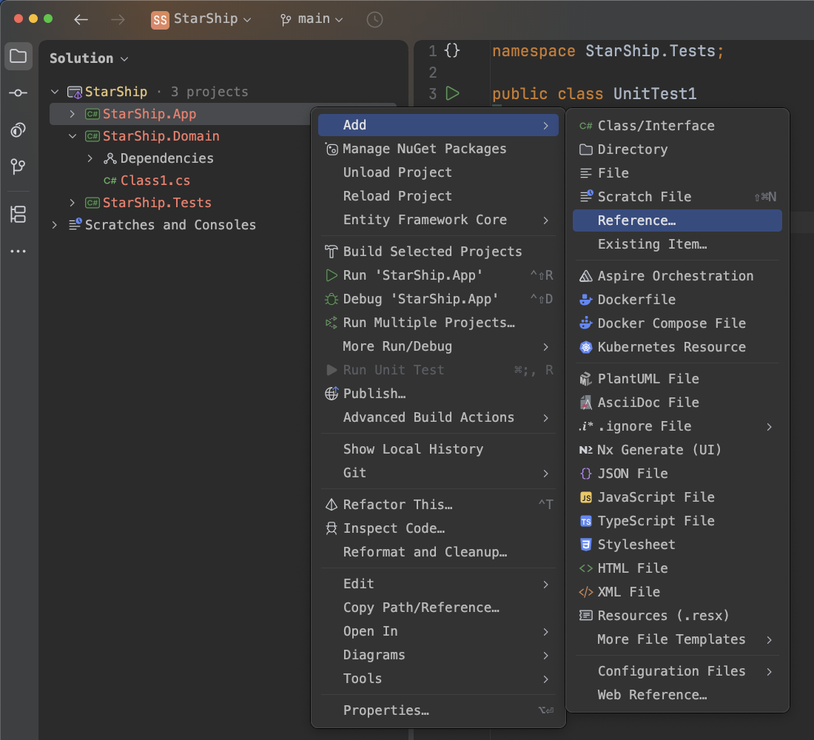

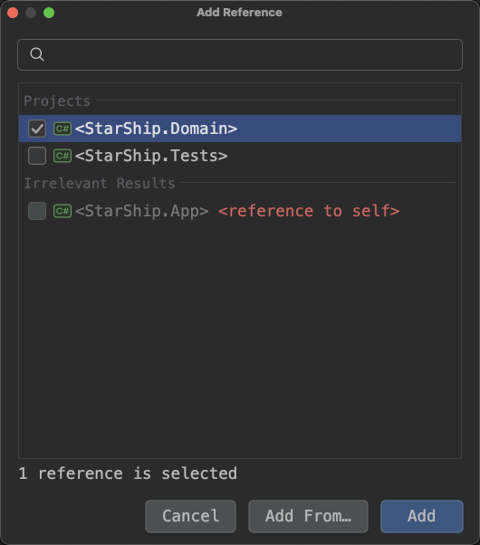

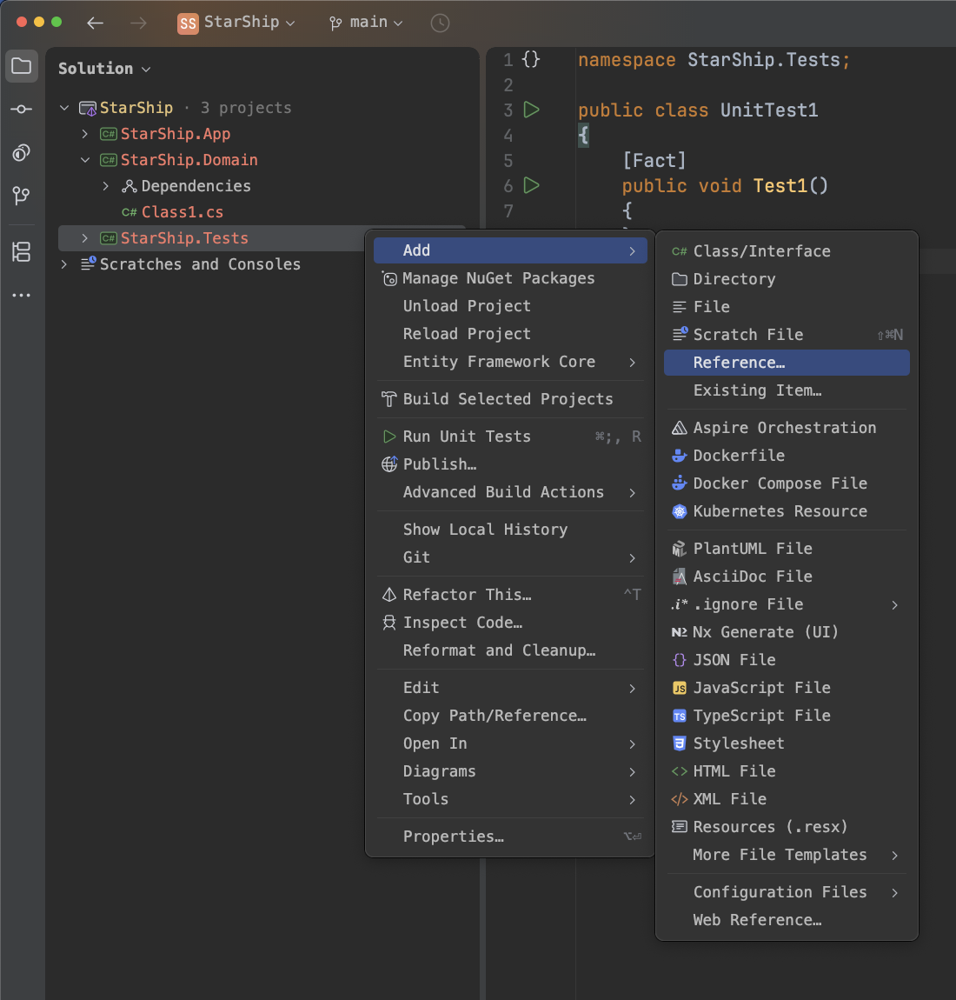

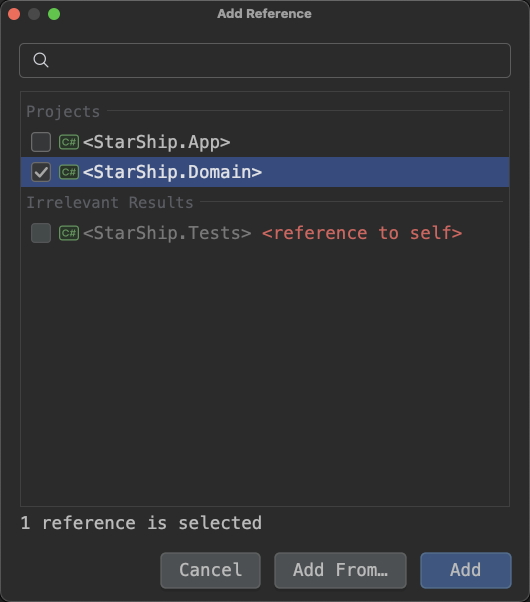

8. Aufräumen: `Class1.cs` und `UnitTest1.cs` löschen, Ordner anlegen wie im Baum unten.

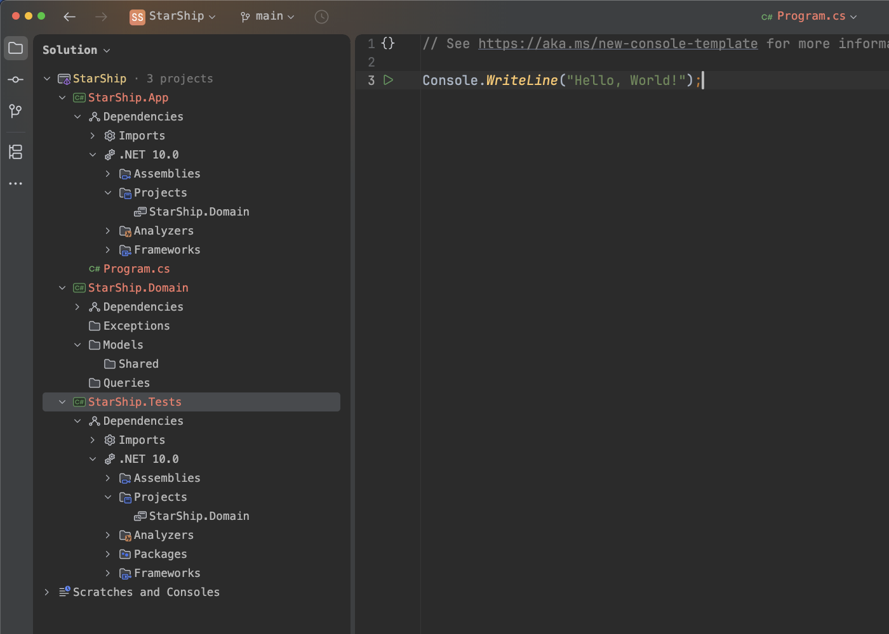

```text
StarShip/
  StarShip.sln
  StarShip.Domain/
    Models/              BaseEntity, Logbook, BaseShip, CargoShip, RescueShip, SpaceStation
    Models/Shared/       Records und Enums
    Exceptions/          StarshipException, Rules
    Queries/             ShipQueries, Fragen an die ganze Flotte, kommt in Akt 2
  StarShip.App/          Program.cs, die Story
  StarShip.Tests/        eure Tests
```

9. In `StarShip.Domain.csproj` in der `PropertyGroup` ergänzen: `<WarningsAsErrors>nullable</WarningsAsErrors>`.
   Damit meldet der Compiler jede mögliche `null` Referenz als Fehler, nicht nur als Warnung.

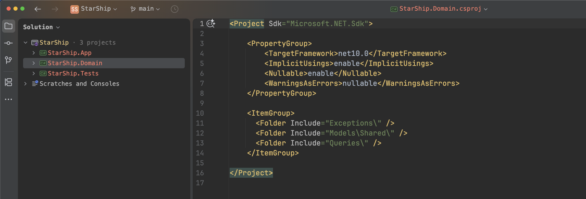

10. `⌘K` (Windows `Ctrl+K`), zweiter Commit: `chore: add solution with domain, app and test projects`.

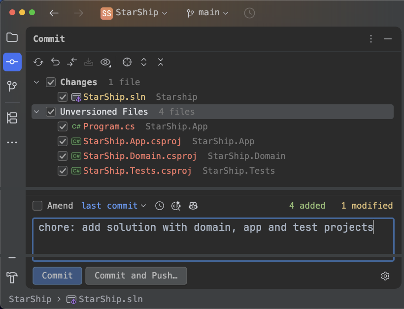

> 💡 Namespaces: `StarShip.Domain.Models`, `StarShip.Domain.Models.Shared`, `StarShip.Domain.Exceptions`, `StarShip.Domain.Queries`.

### 0.2 Domain Model

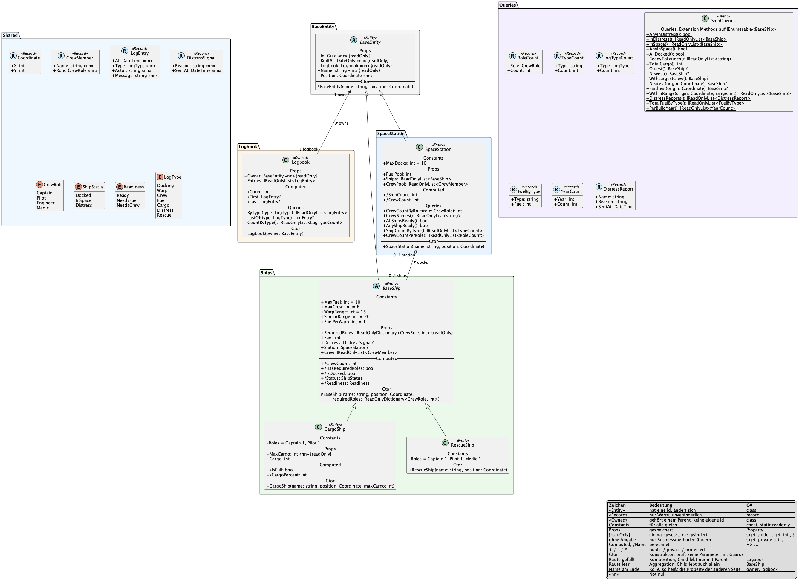

### 0.3 Shared

Shared Types sind Records und Enums, die meistens zwei oder mehr Entities gemeinsam haben. Sie stehen in `Models/Shared` und sind unveränderlich.

#### Enums

Ein Enum ist eine feste Auswahl mit Namen. Andere Werte gibt es nicht, `CrewRole.Captain` ja, eine erfundene Rolle nein.
Rechtsklick auf `Models/Shared`, `Add > New Class/Interface…`, Typ **Enum**.

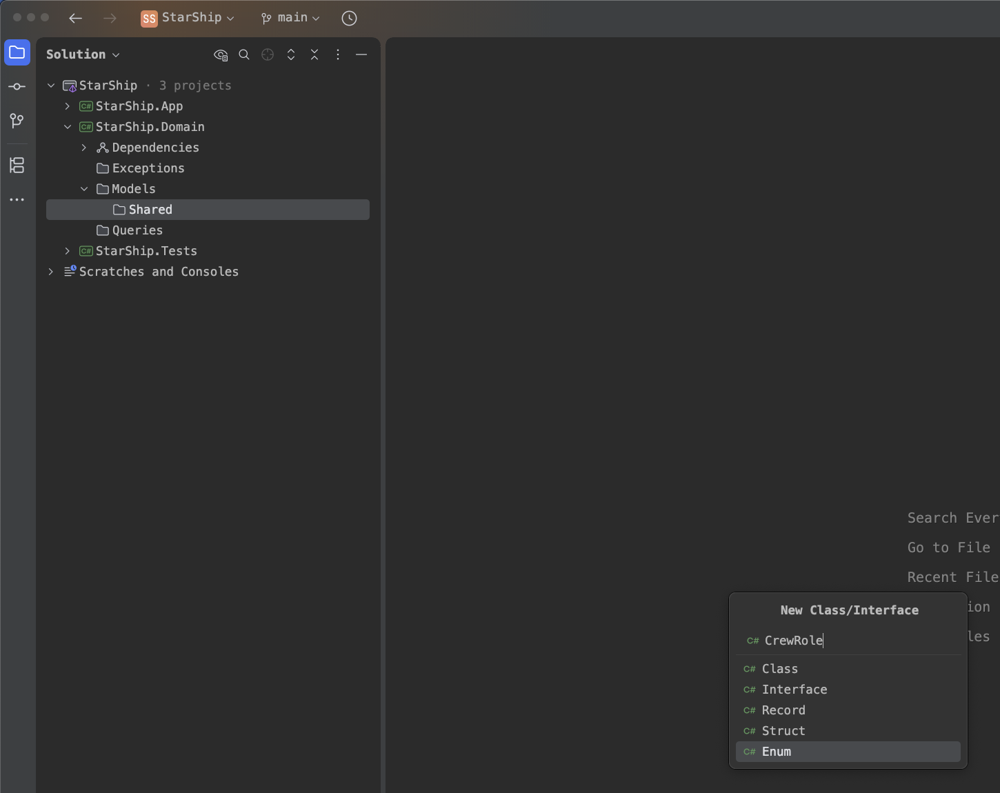

```csharp
public enum CrewRole { Captain, Pilot, Engineer, Medic }
public enum ShipStatus { Docked, InSpace, Distress }
public enum Readiness { Ready, NeedsFuel, NeedsCrew }
public enum LogType { Docking, Warp, Crew, Fuel, Cargo, Distress, Rescue }
```

- **CrewRole**: die vier Aufgaben an Bord, Captain, Pilot, Engineer, Medic.
- **ShipStatus**: wo ein Schiff ist, am Pylon, im All, oder mit Notruf im All.
- **Readiness**: ob ein Schiff starten kann, oder ob Antimaterie oder Crew fehlt.
- **LogType**: die Art eines Logbucheintrags, von Docking bis Rescue.

#### Records

Ein Record ist ein Typ, der nur aus Werten besteht und sich nie ändert. Zwei Records mit gleichen Werten sind gleich.

📖 Nachlesen: [Records](starship-technical-background.md#22-records)

Dasselbe Popup, Typ **Record**.

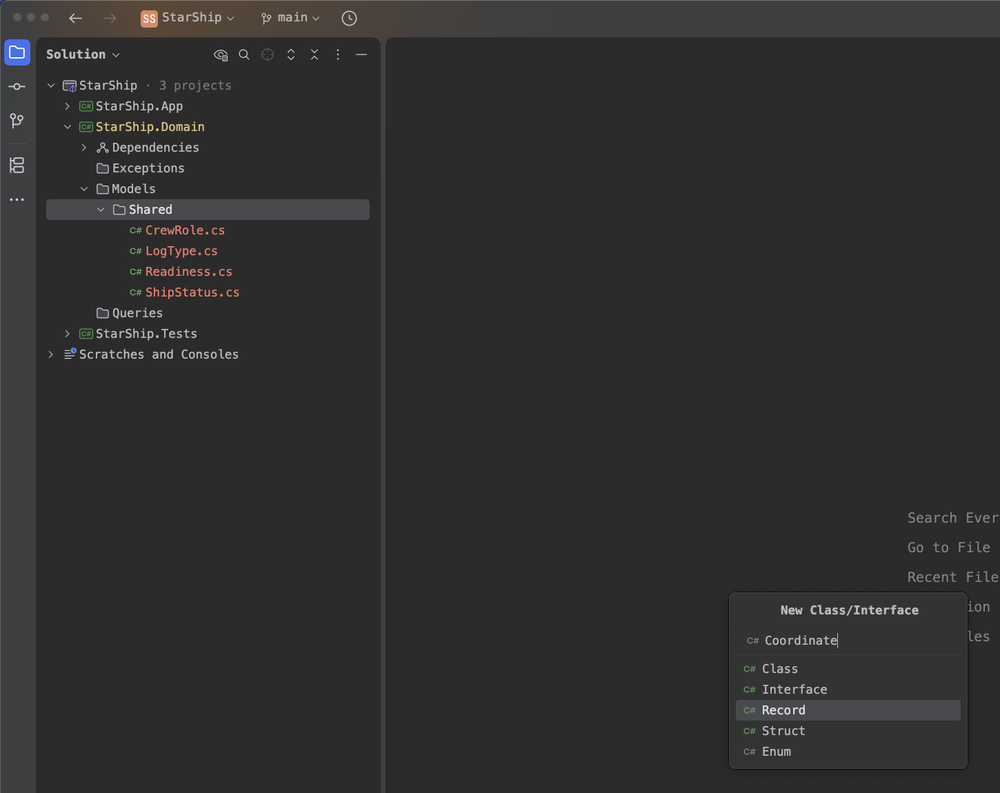

```csharp
public record Coordinate(int X, int Y);
```

- **Coordinate**: ein Punkt im All in Lichtjahren.

```csharp
public record LogEntry(DateTime At, LogType Type, string Actor, string Message);
```

- **LogEntry**: ein Eintrag im Logbuch, wann, welche Art, wer, was. `Actor` ist der Name des Schiffs oder der Station.

```csharp
public record CrewMember
{
    // --- Props ---

    public string Name { get; init; }
    public CrewRole Role { get; init; }

    // --- Ctor ---

    public CrewMember(string name, CrewRole role)
    {
        // Guard: name must not be empty
        ArgumentException.ThrowIfNullOrWhiteSpace(name);

        Name = name.Trim();
        Role = role;
    }
}
```

- **CrewMember**: eine Person mit Namen und Rolle.

```csharp
public record DistressSignal
{
    // --- Props ---

    public string Reason { get; init; }
    public DateTime SentAt { get; init; }

    // --- Ctor ---

    public DistressSignal(string reason, DateTime sentAt)
    {
        // Guard: reason must not be empty
        ArgumentException.ThrowIfNullOrWhiteSpace(reason);

        Reason = reason.Trim();
        SentAt = sentAt;
    }
}
```

- **DistressSignal**: ein Notruf mit Grund und Zeitpunkt.

### 0.4 Exceptions

Die Alarmanlage für gebrochene Regeln. Beides liegt in `Exceptions`.

📖 Nachlesen: [Guards und Rules](starship-technical-background.md#15-business-methods-guards-und-rules), [Primary Constructor](starship-technical-background.md#25-primary-constructor)

```csharp
public class StarshipException(string message) : Exception(message);
```

- Die Exception für gebrochene Regeln: andocken ohne freien Pylon, starten ohne Captain, Notruf im Dock.
- Eine Zeile, weil sie nur die Meldung weiterreicht. Die Entities bekommen später einen ausgeschriebenen Konstruktor, denn dort wird geprüft.

```csharp
public static class Rules
{
    // --- Business Methods ---

    /// <summary>Throws a StarshipException unless the business rule holds.</summary>
    public static void Require(bool condition, string message)
    {
        if (!condition) throw new StarshipException(message);
    }
}
```

- Eine Zeile je Regel: `Rules.Require(ShipCount < MaxDocks, "Kein Pylon frei.")`. Ist die Bedingung falsch, wirft sie die Exception mit der Meldung.

### 0.5 Entities

Eine Entity hat eine Id und ein Leben lang Geschichte. Sie liegen in `Models`, jede in einer eigenen Datei.

📖 Nachlesen: [Entity und Value Object](starship-technical-background.md#17-entity-und-value-object)

#### BaseEntity

Was Station und Schiffe gemeinsam haben. Id, Name, Ort, Baudatum, Logbuch.
Rechtsklick auf `Models`, `Add > New Class/Interface…`, Typ **Class**. So entstehen alle Entities.

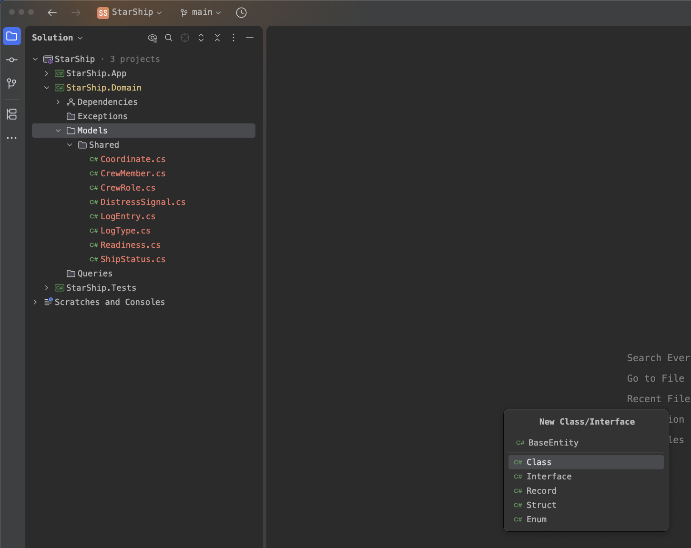

📖 Nachlesen: [Abschnitte einer Klasse](starship-technical-background.md#7-abschnitte-einer-klasse), [Properties](starship-technical-background.md#10-properties), [Auto Properties](starship-technical-background.md#21-auto-properties), [Queries](starship-technical-background.md#11-computed-properties-queries)

```csharp
public abstract class BaseEntity : IEquatable<BaseEntity>
{
    // --- Props ---

    public Guid Id { get; init; } = Guid.CreateVersion7();
    public DateOnly BuiltAt { get; init; } = DateOnly.FromDateTime(DateTime.UtcNow);
    public Logbook Logbook { get; }
    public string Name { get; init; }
    public Coordinate Position { get; private set; }
```

- `Id` ist die eindeutige Kennung jeder Station und jedes Schiffs. Damit weiß die Station, ob die Xhosa schon angedockt ist.
- `BuiltAt` ist das Baujahr. Die Bilanz in Akt 5 fragt nach dem ältesten Schiff.
- `Logbook` ist das eigene Logbuch. Jedes Schiff und jede Station führt eines.
- `Name` ist der Name, so wie er im Report und im Logbuch steht, zum Beispiel „Xhosa".
- `Position` ist der Ort im All. Beim Warp-Sprung ändert er sich, sonst nie.

```csharp
    // --- Ctor ---

    protected BaseEntity(string name, Coordinate position)
    {
        // Guard: name must not be empty, position must not be null
        ArgumentException.ThrowIfNullOrWhiteSpace(name);
        ArgumentNullException.ThrowIfNull(position);

        Name = name.Trim();
        Position = position;
        Logbook = new Logbook(this);
    }
```

- Ein Schiff entsteht mit Namen und Ort. Ohne Namen gibt es kein Schiff.
- Das Logbuch ist vom ersten Moment an dabei. Die Entity erzeugt es selbst und trägt sich als Besitzer ein.

📖 Nachlesen: [Constructor](starship-technical-background.md#12-constructor)

```csharp
    // --- Business Methods ---

    protected void MoveTo(Coordinate target)
    {
        // Guard: target must not be null
        ArgumentNullException.ThrowIfNull(target);

        // Business Logic: change the position
        Position = target;
    }
```

- Die einzige Stelle, an der sich der Ort ändert. Ein Schiff ruft sie beim Warp-Sprung auf, eine Station nie.

```csharp
    // --- Equality ---

    public bool Equals(BaseEntity? other) =>
        other is not null && 
        other.GetType() == GetType() && 
        other.Id == Id;

    public override bool Equals(object? obj) => 
        Equals(obj as BaseEntity);

    public override int GetHashCode() => 
        Id.GetHashCode();
    
    // --- Equality Operators ---

    public static bool operator ==(BaseEntity? left, BaseEntity? right) =>
        left is null ? right is null : left.Equals(right);

    public static bool operator !=(BaseEntity? left, BaseEntity? right) => 
        !(left == right);
}
```

- Zwei Entities sind gleich, wenn sie denselben Typ und dieselbe `Id` haben. Das braucht die Station, wenn sie prüft, ob ein Schiff schon an einem Pylon hängt.
- 📖 Nachlesen: [Equality](starship-technical-background.md#23-equality), [Equality: Operator Overloading](starship-technical-background.md#24-equality-operator-overloading)

#### Logbook

Das Logbuch einer Entity, nur hinten anhängen, nie löschen.

📖 Nachlesen: [Backing Fields](starship-technical-background.md#9-backing-fields), [Beziehungen: Richtung und Anzahl](starship-technical-background.md#18-beziehungen-richtung-und-anzahl)

```csharp
public class Logbook
{
    // --- Fields ---

    private readonly List<LogEntry> _entries = [];

    // --- Props ---

    public BaseEntity Owner { get; }
```

- `_entries` ist die Liste der Einträge. Sie ist privat, niemand von außen kann hineinschreiben oder löschen.
- `Owner` ist die Station oder das Schiff, dem das Logbuch gehört. Ihr Name steht bei jedem Eintrag als Verfasser.

```csharp
    // --- Queries ---

    public IReadOnlyList<LogEntry> Entries => _entries.AsReadOnly();
    public int Count => _entries.Count;
    public LogEntry? First => _entries.FirstOrDefault();
    public LogEntry? Last => _entries.LastOrDefault();
```

- `Entries` ist die Sicht nach außen: alle Einträge in der Reihenfolge, in der sie entstanden sind, nur zum Lesen.
- `Count`, `First` und `Last`: wie viele Einträge, der älteste und der neueste. Bei einem leeren Logbuch sind `First` und `Last` leer.

```csharp
    // --- Ctor ---

    public Logbook(BaseEntity owner)
    {
        // Guard: owner must not be null
        ArgumentNullException.ThrowIfNull(owner);

        Owner = owner;
    }
```

- Ein Logbuch gehört von Anfang an jemandem. Es gibt kein Logbuch ohne Besitzer.

```csharp
    // --- Business Methods ---

    /// <summary>Adds an entry with the current time and the owner as actor.</summary>
    public void Add(LogType type, string message)
    {
        // Guard: message must not be empty
        ArgumentException.ThrowIfNullOrWhiteSpace(message);

        // Business Logic: append only, never remove
        _entries.Add(new LogEntry(DateTime.UtcNow, type, Owner.Name, message.Trim()));
    }
}
```

- Jede Businessmethode ruft am Ende `Logbook.Add` auf: „Xhosa angedockt", „80 t geladen", „NOTRUF: Warpkern überhitzt".
- Die Uhrzeit und der Verfasser kommen von selbst dazu. Wer den Eintrag schreibt, nennt nur die Art und den Text.

#### BaseShip

Die gemeinsame Basis aller Schiffe. Warpkern, Crew, Notruf, Station.

📖 Nachlesen: [Constants](starship-technical-background.md#8-constants)

```csharp
public abstract class BaseShip : BaseEntity
{
    // --- Constants ---

    public const int MaxFuel = 10;
    public const int MaxCrew = 6;
    public const int WarpRange = 15;
    public const int SensorRange = 20;
    public const int FuelPerWarp = 1;
```

- Die Kennwerte der Flotte, für jedes Schiff gleich: Der Warpkern fasst 10 Antimaterie, ein Schiff hat 6 Sitze, ein Warp-Sprung reicht 15 Lichtjahre und verbrennt 1 Antimaterie, der Sensor sieht 20 Lichtjahre weit.

```csharp
    // --- Fields ---

    private readonly List<CrewMember> _crew = [];

    // --- Props ---

    public IReadOnlyDictionary<CrewRole, int> RequiredRoles { get; }
    public int Fuel { get; private set; }
    public DistressSignal? Distress { get; private set; }
    public SpaceStation? Station { get; private set; }

    // --- Queries ---

    public IReadOnlyList<CrewMember> Crew => _crew.AsReadOnly();
    public int CrewCount => _crew.Count;
    public bool IsDocked => Station is not null;
```

- `_crew` ist die Besatzung an Bord, privat. Niemand ist doppelt da, und mehr als `MaxCrew` passen nicht hinein.

- `RequiredRoles` sagt, wer zum Start an Bord sein muss. Ein Frachter braucht Captain und Pilot, das Rettungsschiff zusätzlich einen Medic. Jeder Schiffstyp bringt seine Liste mit.
- `Fuel` ist die Antimaterie im Warpkern, zwischen 0 und `MaxFuel`. Ein neues Schiff startet leer.
- `Distress` ist der aktuelle Notruf. Kein Notruf heißt `null`.
- `Station` ist die Station, an der das Schiff hängt. Im All ist sie `null`.
- `Crew` ist die Sicht auf die Besatzung, nur zum Lesen. `CrewCount` zählt sie, `IsDocked` sagt, ob das Schiff an einer Station hängt. Weitere Queries wie `Status` kommen in Akt 1.

> 💡 `Fuel` steht im Code für Antimaterie, weil es kürzer ist und in jeden Namen passt.

```csharp
    // --- Ctor ---

    protected BaseShip(string name, Coordinate position, IReadOnlyDictionary<CrewRole, int> requiredRoles)
        : base(name, position)
    {
        // Guard: roles not null, a captain is required, all required roles fit on board
        ArgumentNullException.ThrowIfNull(requiredRoles);
        ArgumentOutOfRangeException.ThrowIfLessThan(requiredRoles.GetValueOrDefault(CrewRole.Captain), 1);
        ArgumentOutOfRangeException.ThrowIfGreaterThan(requiredRoles.Values.Sum(), MaxCrew);

        RequiredRoles = requiredRoles;
    }
}
```

- Name und Ort gehen an `BaseEntity` weiter, die Pflichtrollen bleiben hier.
- Jedes Schiff braucht einen Captain, und die Pflichtbesetzung darf nicht größer sein als die Zahl der Sitze.

#### CargoShip und RescueShip

Der Frachter mit Ladung, zum Beispiel die Xhosa, und das Rettungsschiff mit Medic an Bord, die Rio Grande.

```csharp
public class CargoShip : BaseShip
{
    // --- Constants ---

    private static readonly IReadOnlyDictionary<CrewRole, int> Roles =
        new Dictionary<CrewRole, int> { [CrewRole.Captain] = 1, [CrewRole.Pilot] = 1 };

    // --- Props ---

    public int MaxCargo { get; init; }
    public int Cargo { get; private set; }

    // --- Ctor ---

    public CargoShip(string name, Coordinate position, int maxCargo) : base(name, position, Roles)
    {
        // Guard: maxCargo must be positive
        ArgumentOutOfRangeException.ThrowIfNegativeOrZero(maxCargo);

        MaxCargo = maxCargo;
    }
}
```

- `Roles` sind die Pflichtrollen eines Frachters: ein Captain und ein Pilot. Der Konstruktor gibt sie an `BaseShip` weiter.
- `MaxCargo` ist die Ladekapazität in Tonnen, jeder Frachter hat seine eigene: die Xhosa 100, die Bok'Nor 60.
- `Cargo` ist die aktuelle Ladung. Ein neuer Frachter ist leer.

```csharp
public class RescueShip : BaseShip
{
    // --- Constants ---

    private static readonly IReadOnlyDictionary<CrewRole, int> Roles =
        new Dictionary<CrewRole, int> { [CrewRole.Captain] = 1, [CrewRole.Pilot] = 1, [CrewRole.Medic] = 1 };

    // --- Ctor ---

    public RescueShip(string name, Coordinate position) : base(name, position, Roles)
    {
    }
}
```

- Das Rettungsschiff braucht zusätzlich einen Medic, denn wer Menschen aus einem kaputten Schiff holt, muss sie auch versorgen können.
- Eigene Properties hat es keine. Was es kann, kommt in Akt 4 mit `Scan` und `Rescue`.

#### SpaceStation

Deep Space 9 mit Pylonen, Antimaterie-Pool und Crew-Pool.

```csharp
public class SpaceStation : BaseEntity
{
    // --- Constants ---

    public const int MaxDocks = 10;

    // --- Fields ---

    private readonly List<BaseShip> _ships = [];
    private readonly List<CrewMember> _crewPool = [];

    // --- Props ---

    public int FuelPool { get; private set; }

    // --- Queries ---

    public IReadOnlyList<BaseShip> Ships => _ships.AsReadOnly();
    public IReadOnlyList<CrewMember> CrewPool => _crewPool.AsReadOnly();
```

- `MaxDocks`: zehn Schiffe können gleichzeitig an der Station hängen.
- `FuelPool` ist der Antimaterie-Vorrat. Er startet bei 0, der Tanker in Akt 1 füllt ihn.
- `_ships` und `_crewPool` sind die privaten Listen: die angedockten Schiffe und die Leute, die auf ein Schiff warten. Beide füllen sich erst in Akt 1.
- `Ships` und `CrewPool` sind die Sichten nach außen, nur zum Lesen.

```csharp
    // --- Ctor ---

    public SpaceStation(string name, Coordinate position) : base(name, position)
    {
    }
}
```

- Eine Station entsteht mit Namen und Ort, alles andere ist am Anfang leer.

### ✅ Checkpoint

- Alle Typen sind angelegt, `dotnet build` läuft ohne Fehler.
- `git commit -m "feat: domain model with properties and constructors"`

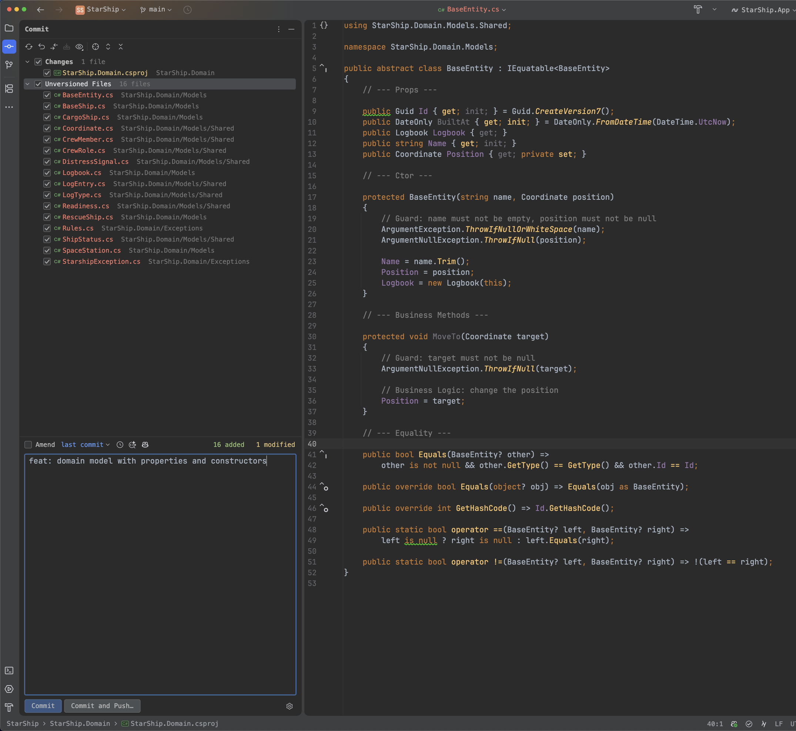

---


## Akt 1: Die Docks öffnen

> *Gegen acht Uhr meldet sich ein bajoranischer Tanker und liefert 40 Einheiten Antimaterie für die neue Route.*
> *Durch die abgeschirmten Leitungen fließt der Vorrat in den Pool der Station, und O'Brien (Ingenieur) prüft jede Anzeige zweimal.*
> *Am Vormittag tauchen nacheinander drei Schiffe am Wurmloch auf: die Frachter Xhosa und Bok'Nor und das Rettungsschiff Rio Grande.*
> *Kira (Captain) dirigiert sie mit dem Headset an die Pylonen, Nog (Pilot) steht daneben und zeigt aufgeregt nach draußen.*
> *Jedes Schiff will andocken und laden, und bei drei Schiffen an einem Vormittag muss jede Regel der Station sitzen.*
> *Odo wacht darüber, dass kein Schiff zweimal andockt und keines mit leerem Warpkern den Pylon blockiert.*

Jeder Akt hat drei Teile: zuerst die Business Methods mit ihren Tests, dann die Queries, zuletzt die Ausgabe mit `Program.cs`.
Ein Abschnitt ist immer eine Klasse. Steht **Demo** im Titel, steht die Lösung dabei.

### Business Methods und Tests

#### 1.1 SpaceStation: AddCrew (Demo)

> *Acht Leute melden sich mit gepackten Taschen zum Dienst: Kira und Worf (Captains), Nog und Dax (Piloten), O'Brien und Rom (Ingenieure), Bashir und Jabara (Medics).*
> *Sie warten im Crew Pool der Station, bis man sie einem Schiff zuteilt.*

**Aufgabe:** Die Station nimmt eine Person in ihren Pool auf. Der Pool ist eine private Liste, von außen gibt es nur die Lesesicht `CrewPool`.
Dieselbe Person darf nicht zweimal im Pool stehen, und jede Aufnahme landet im Logbuch der Station.

Diese Methode ist das Muster für alle anderen. Sie zeigt die vier Schritte einer Businessmethode, deshalb steht sie hier mit Lösung.

📖 Nachlesen: [Business Methods](starship-technical-background.md#13-business-methods), [Guards und Rules](starship-technical-background.md#15-business-methods-guards-und-rules)

```csharp
    /// <summary>Adds a crew member to the crew pool of the station.</summary>
    public void AddCrew(CrewMember member)
    {
        // Guard: member must not be null
        ArgumentNullException.ThrowIfNull(member);

        // Business Rule: not in the pool yet
        Rules.Require(!_crewPool.Contains(member), $"{member.Name} ist schon im Pool von {Name}.");

        // Business Logic: add the member to the pool
        _crewPool.Add(member);

        // Audit Log
        Logbook.Add(LogType.Crew, $"{member} im Pool");
    }
```

- **Guard** prüft den Parameter: keine Person ohne Objekt.
- **Regel** prüft die Situation: Niemand steht zweimal im Pool. `Contains` erkennt das, weil zwei `CrewMember` mit gleichem Namen und gleicher Rolle gleich sind.
- **Logik** ändert den Zustand: Die Person kommt in den Pool.
- **Log** schreibt es auf: „Kira (Captain) im Pool".

#### 1.2 Der erste Test (Demo)

Legt in `StarShip.Tests` die Datei `SpaceStationTests.cs` an. Jeder Test heißt nach dem Muster `Sut_Should_When` und hat drei Teile: Given, When, Then.

📖 Nachlesen: [Tests](starship-technical-background.md#20-tests)

```csharp
using StarShip.Domain.Exceptions;
using StarShip.Domain.Models;
using StarShip.Domain.Models.Shared;

namespace StarShip.Tests;

public class SpaceStationTests
{
    [Fact]
    public void AddCrew_ShouldIncreaseCrewCount_WhenMemberIsNew()
    {
        // Given
        var ds9 = new SpaceStation("Deep Space 9", new Coordinate(100, 200));

        // When
        ds9.AddCrew(new CrewMember("Kira", CrewRole.Captain));

        // Then
        Assert.Equal(1, ds9.CrewCount);
        Assert.Equal(LogType.Crew, ds9.Logbook.Last?.Type);
    }

    [Fact]
    public void AddCrew_ShouldThrow_WhenMemberIsAlreadyInPool()
    {
        // Given
        var ds9 = new SpaceStation("Deep Space 9", new Coordinate(100, 200));
        var kira = new CrewMember("Kira", CrewRole.Captain);
        ds9.AddCrew(kira);

        // When / Then
        Assert.Throws<StarshipException>(() => ds9.AddCrew(kira));
    }
}
```

- Der erste Test prüft den Erfolgsfall: Pool größer, Logbuch hat einen Eintrag.
- Der zweite Test prüft die Regel: Dieselbe Person ein zweites Mal wirft die `StarshipException`.
- Ab jetzt schreibt ihr die Tests selbst. Bei jeder Methode steht, welche.

Tests laufen in Rider mit Rechtsklick auf `StarShip.Tests`, `Run Unit Tests`. Beide müssen grün sein.

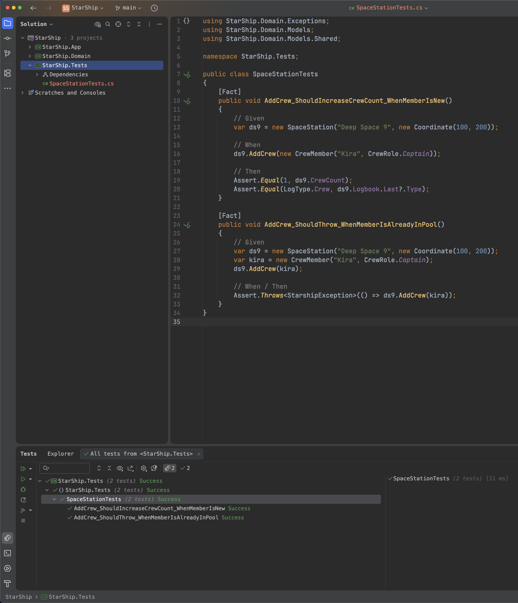

Oder im Terminal mit `dotnet test`, so läuft es später auch auf einem Build Server.

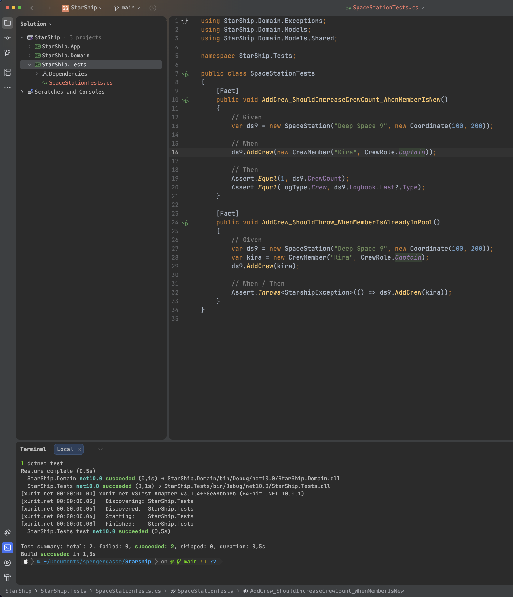

#### 1.3 SpaceStation: Supply

> *Der Tanker koppelt an, und der Pool füllt sich auf 40 Einheiten.*
> *Der Stationsleiter beobachtet die Anzeige genau, denn diese Menge muss für alle Schiffe des Tages reichen.*

**Aufgabe:** Die Station nimmt eine Lieferung Antimaterie an und legt sie in ihren Pool. Die Menge kommt als Parameter,
eine Lieferung von null oder weniger ist ein Programmierfehler und kein Geschäftsfall. Nach der Lieferung steht im Logbuch, wie viel angekommen ist.
`FuelPool` hat `private set`, von außen ändert ihn nur diese Methode.

📖 Nachlesen: [Warum kein public Setter](starship-technical-background.md#14-business-methods-warum-kein-public-setter)

```csharp
public void Supply(int amount)
```
* **Guard:** `amount` größer als 0, sonst `ArgumentOutOfRangeException`
* **Logik:** der Vorrat der Station wächst um die gelieferte Menge
* **Log:** `LogType.Fuel`, „40 Einheiten Antimaterie geliefert"

* **Test:** `Supply_ShouldIncreaseFuelPool_WhenAmountIsPositive`
* **Test:** `Supply_ShouldThrow_WhenAmountIsZero`

#### 1.4 CrewMember: Factory Methods (Demo Captain)

> *In der Hektik des ersten Tages vertippt sich der Dienstplaner ständig bei den Rollen.*
> *Deshalb bekommt jede Rolle eine eigene, kurze Schreibweise.*

**Aufgabe:** Statt `new CrewMember("Kira", CrewRole.Captain)` soll es `CrewMember.Captain("Kira")` geben, für jede der vier Rollen
eine statische Methode, die ein neues `CrewMember` mit fester Rolle liefert. Der Guard im Konstruktor gilt weiter, die Factory wählt nur die Rolle.

📖 Nachlesen: [Factory Method](starship-technical-background.md#32-factory-method)

Die erste Factory Method als Lösung, die drei anderen sehen genauso aus:

```csharp
    /// <summary>Creates a captain with the given name.</summary>
    public static CrewMember Captain(string name) => new(name, CrewRole.Captain);
```

```csharp
public static CrewMember Pilot(string name)
public static CrewMember Engineer(string name)
public static CrewMember Medic(string name)
```
* **Logik:** jede Factory Method erzeugt ein neues `CrewMember` mit dem Namen und ihrer festen Rolle

* **Test:** `Pilot_ShouldHaveRolePilot_WhenCreated`

#### 1.5 SpaceStation: Dock und Undock

> *Die Xhosa erreicht als erstes Schiff den oberen Pylon, und mit einem dumpfen Schlag schließen sich die Andockklammern.*
> *Ab jetzt kennt die Station das Schiff, und das Schiff kennt seine Station, sonst gibt es Chaos im Dock.*

**Aufgabe:** Die Station nimmt ein Schiff an einen Pylon. Die Beziehung hat zwei Seiten, die Liste der Station und die `Station` am Schiff,
und beide müssen immer zusammenpassen. Deshalb setzt die Station beide Seiten in einer Methode und in fester Reihenfolge,
das Schiff macht in 1.6 nur seinen Teil.

📖 Nachlesen: [Beziehungen pflegen](starship-technical-background.md#19-beziehungen-pflegen-der-parent-setzt-beide-seiten)

```csharp
public void Dock(BaseShip ship)
```
* **Guard:** `ship` nicht `null`
* **Regeln:** ein Dock frei (`MaxDocks`), Schiff nicht schon hier (`Ships.Contains`), gleiche Position wie die Station, Schiff nicht angedockt (`IsDocked`)
* **Logik:** das Schiff kommt in die Liste der Station, danach bekommt das Schiff die Station zugewiesen, über `AttachTo` (Parent zuerst, dann Child)
* **Log:** `LogType.Docking`, „Xhosa angedockt"

```csharp
public void Undock(BaseShip ship)
```
* **Guard:** `ship` nicht `null`
* **Regel:** Schiff ist hier angedockt
* **Logik:** umgekehrte Reihenfolge, zuerst aus der Liste, dann `Detach` am Schiff
* **Log:** `LogType.Docking`, „Xhosa abgedockt"

* **Test:** `Dock_ShouldSetBothSides_WhenShipIsInSpace`, prüft `Ships` und `ship.Station`
* **Test:** `Dock_ShouldThrow_WhenShipIsAlreadyDocked`

#### 1.6 BaseShip: AttachTo und Detach

> *Das Schiff merkt sich seinen Pylon. Aber nur die Station darf sagen, wann.*

**Aufgabe:** Das Schiff setzt oder löscht seine `Station`. Beide Methoden sind public, aber durch eine Regel geschützt:
`AttachTo` verlangt, dass die Station das Schiff schon in ihrer Liste hat, `Detach`, dass sie es nicht mehr hat.
Wer sie direkt aufruft, scheitert an der Regel, nicht an der Sichtbarkeit. Nur `Dock` und `Undock` kennen die richtige Reihenfolge.

```csharp
public void AttachTo(SpaceStation station)
public void Detach()
```
* **Guard:** `station` nicht `null`
* **Regeln:** `AttachTo`: noch nicht angedockt, und `station.Ships` enthält das Schiff. `Detach`: angedockt, und `Station.Ships` enthält das Schiff nicht mehr
* **Logik:** `Station` wird gesetzt beziehungsweise auf `null` gesetzt
* **Log:** `LogType.Docking`, „An Deep Space 9 angedockt" und „Von Deep Space 9 abgedockt"

* **Test:** `AttachTo_ShouldThrow_WhenStationDoesNotListTheShip`

#### 1.7 BaseShip: AddFuel

> *Die Antimaterie-Leitung füllt den Warpkern Einheit für Einheit.*
> *Ein überfüllter Warpkern wäre eine Bombe, deshalb stoppt der Zähler genau bei der Obergrenze.*

**Aufgabe:** Das Schiff nimmt Antimaterie in den Warpkern. Es tankt nur im Dock und nie über `MaxFuel` hinaus.
Woher die Antimaterie kommt, weiß das Schiff nicht, das regelt die Station in 1.8.

```csharp
public void AddFuel(int amount)
```
* **Guard:** `amount` größer als 0
* **Regeln:** angedockt, und `Fuel + amount` höchstens `MaxFuel`
* **Logik:** der Warpkern steigt um die Menge
* **Log:** `LogType.Fuel`, „10 Antimaterie geladen, Antimaterie 10/10"

* **Test:** `AddFuel_ShouldThrow_WhenWarpCoreWouldOverflow`

#### 1.8 SpaceStation: Refuel

> *Jede Einheit, die in die Xhosa fließt, fehlt danach im Pool. Der Tanker kommt erst morgen wieder.*

**Aufgabe:** Die Station füllt den Warpkern eines angedockten Schiffs ganz auf. Sie rechnet aus, was fehlt, prüft, ob ihr Pool das hergibt,
und übergibt die Menge über `AddFuel` an das Schiff. Ein volles Schiff lehnt sie ab, ein zu kleiner Pool auch.

```csharp
public void Refuel(BaseShip ship)
```
* **Guard:** `ship` nicht `null`
* **Regeln:** Schiff hier angedockt, Warpkern nicht schon voll, der Pool reicht für die fehlende Menge
* **Logik:** die fehlende Menge wandert aus dem Pool in den Warpkern, das Schiff bucht sie über `AddFuel`, die Station zieht sie vom Pool ab
* **Log:** `LogType.Fuel`, „Xhosa geladen mit 10, Pool 30"

* **Test:** `Refuel_ShouldFillWarpCore_WhenStationHasEnoughFuel`, prüft `Fuel` und `FuelPool`
* **Test:** `Refuel_ShouldThrow_WhenPoolIsTooSmall`

### Queries

#### 1.9 SpaceStation: Queries

> *In der Zentrale laufen alle Zahlen des Tages zusammen: wie viele Schiffe an den Pylonen hängen, wer im Pool wartet und welche Rollen fehlen.*
> *Sisko (Kommandant) will diese Zahlen nicht aus Listen abzählen, die Station soll sie selbst wissen, in jedem Moment aktuell.*

**Aufgabe:** Die Station beantwortet Fragen über ihre Listen, ohne etwas zu speichern. Jede Query rechnet beim Zugriff aus `Ships` oder `CrewPool`,
deshalb ist sie nie veraltet. Vier Queries, von einem Operator bis drei, alle im Abschnitt `// --- Queries ---`.

📖 Nachlesen: [Queries](starship-technical-background.md#11-computed-properties-queries)

```csharp
public int ShipCount => ...
```
* **Ergebnis:** Anzahl der angedockten Schiffe

```csharp
public int CrewCountByRole(CrewRole role)
```
* **Operatoren:** Count
* **Ergebnis:** wie viele Personen mit dieser Rolle im Pool warten
* **Beispiel:** nach Akt 1 liefert `Pilot` den Wert 2

```csharp
public IReadOnlyList<string> CrewNames()
```
* **Operatoren:** Select, ToList
* **Ergebnis:** die Namen aller Personen im Pool, in Pool-Reihenfolge

```csharp
public IReadOnlyList<RoleCount> CrewCountPerRole()
```
* **Operatoren:** GroupBy, Select, OrderBy
* **Ergebnis:** pro Rolle die Anzahl im Pool, aufsteigend nach Rolle
* **Beispiel:** `(Captain, 2), (Pilot, 2), (Engineer, 2), (Medic, 2)`

`RoleCount` ist ein Positional Record im Ordner `Queries` mit einem `ToString`, das `Captain: 2` liefert (Vorlage `CrewMember`):

```csharp
public record RoleCount(CrewRole Role, int Count)
{
    public override string ToString() => $"{Role}: {Count}";
}
```

* **Test:** `CrewCountByRole_ShouldReturnTwo_WhenTwoPilotsAreInPool`
* **Test:** `CrewCountPerRole_ShouldReturnFourGroups_WhenPoolHasAllRoles`

#### 1.10 BaseShip: Queries

> *Auf dem Hauptschirm hat jedes Schiff eine Farbe für den Ort und ein Häkchen für die Startfreigabe.*
> *Beides rechnet das Schiff selbst aus, niemand muss es setzen, und deshalb ist es nie veraltet.*

**Aufgabe:** Ein Schiff weiß über sich, ob die Pflichtrollen komplett sind, welche fehlen, wo es ist (`Status`) und ob es starten darf (`Readiness`).
Alles sind Queries über `Crew`, `Station`, `Distress` und `Fuel`, nichts davon wird gespeichert.

📖 Nachlesen: [Pattern Matching](starship-technical-background.md#26-pattern-matching), [Von if zur Switch Expression](starship-technical-background.md#27-von-if-zur-switch-expression)

`HasRequiredRoles` ist die erste Query, bei der ein Operator in einem anderen steckt. Der Anfang als Teaser:

```csharp
public bool HasRequiredRoles => RequiredRoles.All(r => ...);
```
* **Operatoren:** All, darin Count
* **Ergebnis:** `true`, wenn für jede Pflichtrolle (`r.Key`) mindestens `r.Value` Personen dieser Rolle an Bord sind
* **Beispiel:** Xhosa mit Kira (Captain) und Nog (Pilot) liefert `true`, nur mit Kira `false`

```csharp
public IReadOnlySet<CrewRole> MissingRoles()
```
* **Operatoren:** Where, Count, ToHashSet
* **Ergebnis:** die Menge aller Rollen, von denen weniger an Bord sind als gefordert. Rollen, die nicht in `RequiredRoles` stehen, fehlen nie.
* **Beispiel:** Xhosa ohne Crew liefert `{ Captain, Pilot }`, mit Kira an Bord nur `{ Pilot }`, mit beiden die leere Menge

```csharp
public ShipStatus Status => ...
```
* **Logik:** Switch Expression über `this` mit Property Patterns, die erste passende Zeile gewinnt

| Reihenfolge | Bedingung | Ergebnis |
|---|---|---|
| 1 | `Distress` ist nicht `null` | `Distress` |
| 2 | `Station` ist `null` | `InSpace` |
| 3 | sonst | `Docked` |

```csharp
public Readiness Readiness => ...
```
* **Logik:** dieselbe Form, drei Zeilen

| Reihenfolge | Bedingung | Ergebnis |
|---|---|---|
| 1 | `HasRequiredRoles` ist `false` | `NeedsCrew` |
| 2 | `Fuel` kleiner als `MaxFuel` | `NeedsFuel` |
| 3 | sonst | `Ready` |

> 💡 `{ Fuel: < MaxFuel }` funktioniert nur, weil `MaxFuel` eine `const` ist. Ein Pattern verlangt einen konstanten Wert.

* **Test:** `Status_ShouldBeInSpace_WhenShipHasNoStation`
* **Test:** `Readiness_ShouldBeNeedsCrew_WhenCaptainIsMissing`
* **Test:** `MissingRoles_ShouldReturnPilot_WhenOnlyCaptainIsOnBoard`

### Ausgabe und Program.cs

#### 1.11 Coordinate: ToString (Demo)

> *Auf jedem Schirm der Station steht ein Ort in Lichtjahren.*

**Aufgabe:** Eine Koordinate schreibt sich als `(X,Y) Lichtjahre`, ohne Leerzeichen nach dem Komma. Der Compiler hat für den Record
schon ein `ToString` erzeugt, das `Coordinate { X = 100, Y = 200 }` ausgibt, deshalb überschreiben wir es.

📖 Nachlesen: [Strings](starship-technical-background.md#31-strings)

```csharp
    /// <summary>Formats the coordinate as (X,Y) Lichtjahre.</summary>
    public override string ToString() => $"({X},{Y}) Lichtjahre";
```

- **override** ersetzt die Fassung des Compilers. Ohne `override` gäbe es zwei `ToString`, und der Compiler nähme seine.

#### 1.12 BaseEntity: ToString

> *Und jedes Schiff und jede Station steht in einer Zeile: Name und Ort.*

**Aufgabe:** Jede Entity beschreibt sich in einer Zeile mit Name und Position. Die Position nutzt dabei ihr eigenes `ToString` aus 1.11,
niemand formatiert Koordinaten zweimal.

```csharp
public override string ToString()
```
* **Logik:** liefert den Namen, das Wort „bei" und die Position, zum Beispiel `Deep Space 9 bei (100,200) Lichtjahre`

#### 1.13 CrewMember: ToString

> *Jeder Name auf dem Schirm zeigt die Rolle in Klammern.*

**Aufgabe:** Eine Person schreibt sich als Name mit der Rolle in runden Klammern. So steht sie später im Logbuch und im Report.

```csharp
public override string ToString()
```
* **Logik:** liefert Name, Leerzeichen, Rolle in Klammern, zum Beispiel `Kira (Captain)`

#### 1.14 SpaceStation: Report (Demo)

> *Auf dem Hauptschirm hat die Station eine eigene Kachel mit allen Werten auf einen Blick.*
> *Die Flugsicherung will nicht suchen, sie will lesen.*

**Aufgabe:** `Report` liefert einen mehrzeiligen Block für den Bildschirm: Kopfzeile mit Name und Typ, darunter je eine Zeile pro Wert,
Beschriftung und Wert in Spalten. Die Domäne schreibt nicht auf die Konsole, sie liefert den String, `Program.cs` gibt ihn aus.

```csharp
    /// <summary>Describes the station as a block of lines.</summary>
    public string Report() =>
        $"""
        {Name} (SpaceStation)
          {"Position",-12}{Position}
          {"Fuel Pool",-12}{FuelPool}
          {"Docks",-12}{ShipCount}/{MaxDocks}: {NamesOrDash(Ships.Select(s => s.Name))}
          {"Crew Pool",-12}{CrewCount}: {NamesOrDash(CrewPool.Select(c => c.ToString()))}
        """;
```

- **Raw String Literal** über mehrere Zeilen, die Einrückung der schließenden `"""` wird abgezogen.
- **`{"Docks",-12}`** füllt die Beschriftung auf 12 Zeichen auf, so entstehen die Spalten.
- **`NamesOrDash`** ist ein privater Helper im Abschnitt `// --- Helpers ---`: Namen mit `, ` verbinden, bei leerer Liste ein `-`.

#### 1.15 BaseShip: Report

> *Und jedes Schiff hat seine Kachel daneben.*

**Aufgabe:** Dasselbe für ein Schiff: Kopfzeile `Name (Typ)`, dann Status, Readiness, Position, Fuel, Crew. `Report` ist `virtual`,
weil der Frachter in Akt 2 eine Zeile anhängt. `ToString` bleibt eine Zeile für Meldungen, `Report` ist der Block für den Schirm.

```csharp
public virtual string Report()
```
* **Logik:** Kopfzeile mit `GetType().Name`, dann die fünf Zeilen mit zwei Leerzeichen eingerückt, Fuel als `Fuel/MaxFuel`, Crew als `Anzahl/MaxCrew: Namen`, bei leerer Crew ein `-`

Euer Report muss genau so aussehen wie in der erwarteten Ausgabe unten.

#### 1.16 Logbook: ToString

**Aufgabe:** Das Logbuch beschreibt sich in einer Zeile mit Besitzer und Anzahl der Einträge.

```csharp
public override string ToString()
```
* **Logik:** liefert „Logbuch Xhosa, 7 Einträge"

#### 1.17 Program.cs: Akt 1

> *Der erste Tag läuft wie ein Drehbuch: Pool füllen, Tanker, drei Schiffe, zwei Berichte.*

**Aufgabe:** `Program.cs` ist die App-Schicht. Sie erzeugt die Objekte, ruft die Methoden der Domäne in Story-Reihenfolge auf und gibt aus,
was die Domäne liefert. Die Domäne schreibt nie selbst auf die Konsole, jedes `Console.WriteLine` steht hier. Jeder Block ist ein `TODO`,
das die Story erzählt, darunter die Zeilen, die ihr dafür schreibt. In Akt 1 bis 3 stehen sie ausgeschrieben da, ab Akt 4 nur noch,
welche Methode ihr ruft.

```csharp
using StarShip.Domain.Models;
using StarShip.Domain.Models.Shared;

// ------ AKT 1 ------
Console.WriteLine("=== AKT 1: Die Docks öffnen ===");

// TODO: Sternzeit 49011.4, die neue Deep Space 9 geht in Betrieb. Die Station steht bei (100,200), gebaut 2351.
//       var home = new Coordinate(100, 200);
//       var ds9 = new SpaceStation("Deep Space 9", home) { BuiltAt = new DateOnly(2351, 1, 1) };

// TODO: Acht Leute melden sich zum Dienst und warten im Pool. Die Reihenfolge zählt, die Station teilt später der Reihe nach zu.
//       ds9.AddCrew(CrewMember.Captain("Kira"));
//       dieselbe Zeile für Worf (Captain), Nog und Dax (Pilot), O'Brien und Rom (Engineer), Bashir und Jabara (Medic)

// TODO: Der Tanker liefert 40 Einheiten Antimaterie, das muss für alle Schiffe des Tages reichen.
//       ds9.Supply(40);

// TODO: Drei Schiffe tauchen am Wurmloch auf und stehen bei home. Die Liste fleet hält alle drei, denn die Station kennt
//       später nur die angedockten, und die Queries ab Akt 2 fragen die ganze Flotte.
//       var xhosa = new CargoShip("Xhosa", home, 100) { BuiltAt = new DateOnly(2360, 5, 12) };
//       genauso bokNor (60 t, BuiltAt 2355-07-01) und rioGrande als RescueShip ohne Tonnen (BuiltAt 2369-11-20)
//       List<BaseShip> fleet = [xhosa, bokNor, rioGrande];

// TODO: Alle drei docken an. Xhosa und Bok'Nor tanken voll, die Rio Grande noch nicht, sie fliegt heute nicht.
//       ds9.Dock(xhosa);
//       dieselbe Zeile für bokNor und rioGrande
//       ds9.Refuel(xhosa);
//       dieselbe Zeile für bokNor

// TODO: Sisko will Zahlen sehen: wie viele Piloten warten, und wer im Pool ist, je Rolle. Die Liste schreibt sich selbst, string.Join reiht sie auf.
//       Console.WriteLine($"Piloten im Pool: {ds9.CrewCountByRole(CrewRole.Pilot)}");
//       Console.WriteLine($"Crew je Rolle: {string.Join(", ", ds9.CrewCountPerRole())}");

// TODO: Zwei Kacheln auf dem Hauptschirm, die Station und die Xhosa, je eine Leerzeile davor. Report liefert den Text, WriteLine zeigt ihn.
//       Console.WriteLine();
//       Console.WriteLine(ds9.Report());
//       Console.WriteLine();
//       Console.WriteLine(xhosa.Report());
```

- **Object Initializer** `{ BuiltAt = ... }` setzt die `init` Property nach dem Konstruktor.
- **string.Join** ruft auf jedem Element `ToString()` auf und verbindet mit Komma. Deshalb hat `RoleCount` ein `ToString`.
- Eine Regelverletzung, zum Beispiel die Xhosa zweimal andocken, lässt das Programm mit `StarshipException` abbrechen. Das ist gewollt, Regeln prüft ihr in den Tests.

Erwartete Ausgabe:

```text
=== AKT 1: Die Docks öffnen ===
Piloten im Pool: 2
Crew je Rolle: Captain: 2, Pilot: 2, Engineer: 2, Medic: 2

Deep Space 9 (SpaceStation)
  Position    (100,200) Lichtjahre
  Fuel Pool   20
  Docks       3/10: Xhosa, Bok'Nor, Rio Grande
  Crew Pool   8: Kira (Captain), Worf (Captain), Nog (Pilot), Dax (Pilot), O'Brien (Engineer), Rom (Engineer), Bashir (Medic), Jabara (Medic)

Xhosa (CargoShip)
  Status      Docked
  Readiness   NeedsCrew
  Position    (100,200) Lichtjahre
  Fuel        10/10
  Crew        0/6: -
```

Die Zeile `Cargo` kommt erst in Akt 2 dazu, wenn `CargoShip.Report` überschrieben wird.

### ✅ Checkpoint

* Alle Tests aus 1.3 bis 1.10 sind grün
* `dotnet run` zeigt die Ausgabe oben
* `git commit -m "feat: act 1 docking and refueling"`

---

## Akt 2: Xhosa läuft aus

> *Die Xhosa ist geladen, aber der Frachter liegt noch ohne Crew und ohne Fracht am Pylon.*
> *Kasidy Yates (Frachterkapitänin) will noch heute auslaufen, denn die Kolonien auf Bajor warten auf ihre Lieferung.*
> *Der erste Startversuch scheitert peinlich, weil niemand an Bord ist.*
> *Also teilt die Station Kira als Captain und Nog als Piloten zu, und die Kräne heben 80 Tonnen Container in den Laderaum.*
> *Dann lösen sich die Klammern, und die Xhosa nimmt Kurs auf den Punkt (145,200), drei Warp-Sprünge entfernt.*
> *Zwei Sprünge später ist die Station nur noch ein kleiner Lichtpunkt hinter dem Heck.*

### Business Methods und Tests

#### 2.1 Coordinate: DistanceTo

> *Bevor Nog den Warp-Antrieb startet, will er genau wissen, wie viele Lichtjahre das Ziel entfernt ist.*
> *Ein Fehler von nur einem Lichtjahr kann im All den Unterschied zwischen Ankunft und Verschwinden machen.*

**Aufgabe:** Unser All ist eine Ebene mit den Achsen X und Y. Der Abstand zweier Punkte ist die Hypotenuse eines rechtwinkligen Dreiecks
aus `dx` und `dy` (Satz des Pythagoras, `Math.Sqrt`). Das Ergebnis bleibt ein `double`, gerundet wird erst beim Warp-Sprung, nicht beim Messen.

```text
  (x1,y1)      (x2,y2)
     *----------*
von (100,200) nach (145,200):   dx = 45, dy = 0    Abstand = 45 Lichtjahre
```

```csharp
public double DistanceTo(Coordinate other)
```
* **Logik:** Wurzel aus `dx` zum Quadrat plus `dy` zum Quadrat, ungerundet

* **Test:** `DistanceTo_ShouldReturnFive_WhenPointsAreThreeAndFourApart`

#### 2.2 BaseEntity: DistanceTo

**Aufgabe:** Jede Entity kann ihren Abstand zu einem Punkt oder zu einer anderen Entity messen. Beide Methoden heißen gleich und unterscheiden
sich nur im Parameter (Überladung), beide leiten an `Position.DistanceTo` weiter. Niemand rechnet Pythagoras zweimal.

```csharp
public double DistanceTo(Coordinate target)
public double DistanceTo(BaseEntity other)
```
* **Guard:** `other` nicht `null`
* **Logik:** die erste fragt die eigene Position nach dem Abstand zum Ziel, die zweite nimmt dafür die Position der anderen Entity

#### 2.3 BaseShip: Board und Unboard

> *Über die Gangway geht eine Person an Bord oder verlässt das Schiff wieder.*
> *Ein Schiff hat nur eine begrenzte Zahl an Sitzen, und niemand darf zweimal an Bord sein.*

**Aufgabe:** Das Schiff nimmt eine Person in seine Crew auf oder lässt sie von Bord. Die Crew ist eine private Liste mit Lesesicht `Crew`,
höchstens `MaxCrew` Personen, keine doppelt. Woher die Person kommt, weiß das Schiff nicht, das regelt die Station in 2.4.

```csharp
public void Board(CrewMember member)
```
* **Guard:** `member` nicht `null`
* **Regeln:** ein Platz frei (`CrewCount` kleiner als `MaxCrew`), Person noch nicht an Bord
* **Logik:** die Person kommt in die Crew
* **Log:** `LogType.Crew`, „Kira (Captain) an Bord"

```csharp
public void Unboard(CrewMember member)
```
* **Guard:** `member` nicht `null`
* **Regel:** Person ist an Bord
* **Logik:** die Person verlässt die Crew
* **Log:** `LogType.Crew`, „Kira (Captain) von Bord"

* **Test:** `Board_ShouldThrow_WhenShipIsFull`

#### 2.4 SpaceStation: AssignCrew und UnassignCrew

> *Der Dienstplan der Station schickt genau die Leute aufs Schiff, die dort noch fehlen.*
> *Fehlt im Pool auch nur eine Rolle, bleibt das ganze Team zu Hause, denn ein halbes Team ist schlimmer als keins.*

**Aufgabe:** Die Station besetzt ein angedocktes Schiff aus ihrem Pool. Sie fragt das Schiff nach `MissingRoles`, sucht für jede fehlende Rolle
die nötige Anzahl im Pool und erst wenn alle gefunden sind, gehen sie über `Board` an Bord und verlassen den Pool. `UnassignCrew` holt die
ganze Crew zurück. Erst prüfen, dann ändern, sonst sitzt am Ende ein Captain an Bord und der Pilot fehlt.

📖 Nachlesen: [Helpers](starship-technical-background.md#16-helpers)

```csharp
public void AssignCrew(BaseShip ship)
```
* **Guard:** `ship` nicht `null`
* **Regeln:** Schiff hier angedockt, der Pool hat jede fehlende Rolle in der nötigen Anzahl, das Schiff hat genug Sitze
* **Logik:** zuerst alle fehlenden Personen aus dem Pool auswählen, in Pool-Reihenfolge (ein privater Helper), dann jede Person über `Board` aufs Schiff und aus dem Pool
* **Log:** `LogType.Crew`, „2 Personen an Xhosa zugeteilt"

```csharp
public void UnassignCrew(BaseShip ship)
```
* **Guard:** `ship` nicht `null`
* **Regel:** Schiff hier angedockt
* **Logik:** jede Person der Crew über `Unboard` zurück in den Pool
* **Log:** `LogType.Crew`, „5 Personen von Rio Grande zurück im Pool"

* **Test:** `AssignCrew_ShouldBoardCaptainAndPilot_WhenPoolHasBoth`
* **Test:** `AssignCrew_ShouldThrow_WhenPoolHasNoPilot`, prüft auch, dass niemand an Bord ging

#### 2.5 CargoShip: Load und Unload

> *Die großen Kräne heben Container um Container in den Laderaum der Xhosa.*
> *Mehr als die Ladekapazität geht nicht, sonst knickt der Rumpf beim ersten Warp-Sprung.*

**Aufgabe:** Der Frachter nimmt Fracht in Tonnen auf oder gibt sie ab, nur im Dock, nie über `MaxCargo` und nie mehr ab, als geladen ist.
`Cargo` hat `private set`, von außen ändert sich die Ladung nur über diese zwei Methoden.

```csharp
public void Load(int tons)
```
* **Guard:** `tons` größer als 0
* **Regeln:** angedockt, und `Cargo + tons` höchstens `MaxCargo`
* **Logik:** die Ladung steigt um die Tonnen
* **Log:** `LogType.Cargo`, „80 t geladen, 80/100"

```csharp
public void Unload(int tons)
```
* **Guard:** `tons` größer als 0
* **Regeln:** angedockt, und nie mehr entladen, als geladen ist
* **Logik:** die Ladung sinkt um die Tonnen
* **Log:** `LogType.Cargo`, „80 t entladen, 0/100"

* **Test:** `Load_ShouldThrow_WhenCargoWouldExceedMaxCargo`

#### 2.6 BaseShip: Launch

> *Kira gibt das Kommando zum Ablegen, und die Station lässt das Schiff frei.*
> *Fehlt eine Rolle oder die Antimaterie, verweigert die Station den Start und nennt den Grund.*

**Aufgabe:** Das Schiff legt ab. Es prüft seine Startbedingungen selbst und bittet dann seine Station, es über `Undock` freizugeben.
`Station` ist `SpaceStation?`, deshalb holt ihr sie ohne `!` mit einer Throw Expression: `var station = Station ?? throw new StarshipException(...)`.
Die Meldung bei fehlender Crew nennt die fehlenden Rollen aus `MissingRoles`.

📖 Nachlesen: [Nullable](starship-technical-background.md#30-nullable)

```csharp
public void Launch()
```
* **Regeln:** angedockt, `HasRequiredRoles` (die Meldung nennt `MissingRoles`), Warpkern voll (`Fuel == MaxFuel`)
* **Logik:** die Station gibt das Schiff über `Undock` frei, das Schiff selbst ändert nichts

* **Test:** `Launch_ShouldUndock_WhenShipIsReady`
* **Test:** `Launch_ShouldThrow_WhenCaptainIsMissing`, prüft, dass die Meldung „Captain" enthält

#### 2.7 BaseShip: HasEnoughFuelTo und CanWarpTo

> *Bevor der Pilot den Kurs setzt, rechnet der Bordcomputer nach, ob die Antimaterie bis zum Ziel reicht.*
> *Wer auf halbem Weg mit leerem Warpkern stehen bleibt, braucht selbst eine Rettung.*

**Aufgabe:** Zwei Fragen vor jedem Sprung. `HasEnoughFuelTo` rechnet, wie viele Sprünge das Ziel entfernt ist: Abstand durch `WarpRange`,
aufgerundet mit `Math.Ceiling`, jeder Sprung kostet `FuelPerWarp`. `CanWarpTo` fasst alle Startbedingungen für einen Sprung zusammen.
Die Überladung mit der Station nimmt deren Position. Beide ändern nichts, sie antworten nur.

```csharp
public bool HasEnoughFuelTo(Coordinate target)
```
* **Logik:** `true`, wenn die Antimaterie für die aufgerundete Anzahl Sprünge reicht

```csharp
public bool CanWarpTo(Coordinate target)
public bool CanWarpTo(SpaceStation station)
```
* **Logik:** im All, Pflichtrollen an Bord, genug Antimaterie bis zum Ziel. Die Überladung leitet mit `station.Position` an die erste weiter

#### 2.8 BaseShip: WarpTo

> *Ein Warp-Sprung bringt das Schiff höchstens 15 Lichtjahre näher ans Ziel, und jeder Sprung verbrennt eine Einheit Antimaterie.*
> *Draußen ziehen sich die Sterne zu Streifen, und das Logbuch notiert jede neue Position.*

**Aufgabe:** Das Schiff springt Richtung Ziel. Liegt das Ziel innerhalb `WarpRange`, kommt es genau dort an, sonst `WarpRange` Lichtjahre
auf der Geraden zum Ziel, mit `Math.Round` auf ganze Koordinaten. Die neue Position setzt ihr über `MoveTo` aus `BaseEntity`, nie direkt.
Die Überladung mit der Station springt dorthin und dockt bei Ankunft an.

```csharp
public void WarpTo(Coordinate target)
```
* **Guard:** `target` nicht `null`
* **Regeln:** im All, Pflichtrollen an Bord, genug Antimaterie bis zum Ziel (also `CanWarpTo`)
* **Logik:** neue Position berechnen, über `MoveTo` setzen, danach `Fuel` um `FuelPerWarp` senken
* **Log:** `LogType.Warp`, „Warp-Sprung nach (115,200) Lichtjahre, Antimaterie 9/10"

```csharp
public void WarpTo(SpaceStation station)
```
* **Guard:** `station` nicht `null`
* **Logik:** springt Richtung `station.Position`, und wenn das Schiff danach dort steht, ruft es `station.Dock(this)` auf

* **Test:** `WarpTo_ShouldMoveWarpRangeAndBurnOneFuel_WhenTargetIsFar`
* **Test:** `WarpTo_ShouldThrow_WhenFuelDoesNotReachTarget`

### Queries

#### 2.9 CargoShip: Queries

**Aufgabe:** Der Frachter weiß, ob er voll ist und wie voll in Prozent. Beides rechnet er aus `Cargo` und `MaxCargo`.

```csharp
public bool IsFull => ...
public int CargoPercent => ...
```
* **Ergebnis:** `true` bei `Cargo == MaxCargo`, und die Auslastung in ganzen Prozent (Integer-Division, 80 von 100 ist 80)

#### 2.10 ShipQueries: Fragen an die Flotte (Demo InSpace)

> *Am Abend will Sisko (Kommandant) wissen, wer im All ist, wer startklar wäre, wie viel Fracht unterwegs ist und wie viel Antimaterie pro Schiffstyp noch im Umlauf ist.*
> *Die Station kennt nur ihre angedockten Schiffe. Für die ganze Flotte braucht Sisko eine Liste, die alle enthält.*

**Aufgabe:** Fragen an mehrere Schiffe gehören zu keiner Entity. Sie stehen als Extension Methods in der statischen Klasse `ShipQueries`
im Ordner `Queries` und hängen an `IEnumerable<BaseShip>`. Wer sie aufruft, gibt die Schiffe mit: in `Program.cs` die Liste `fleet` mit
allen drei Schiffen, egal ob angedockt oder im All, oder `ds9.Ships`, dann nur die angedockten. Ergebnisse mit mehreren Werten je Zeile sind
Positional Records im Ordner `Queries`.

📖 Nachlesen: [Extension Methods](starship-technical-background.md#28-extension-methods), [Records](starship-technical-background.md#22-records)

Die erste als Lösung. Legt im Ordner `Queries` die Datei `ShipQueries.cs` an, eine statische Klasse, die Methode mit `this` vor dem Parameter:

```csharp
using StarShip.Domain.Models;
using StarShip.Domain.Models.Shared;

namespace StarShip.Domain.Queries;

public static class ShipQueries
{
    // LINQ: Where, ToList
    /// <summary>All ships that are in space without distress.</summary>
    public static IReadOnlyList<BaseShip> InSpace(this IEnumerable<BaseShip> ships) =>
        ships.Where(s => s.Status == ShipStatus.InSpace).ToList();
}
```

Und so wird sie benutzt, in `Program.cs`. Das `using` für den Namespace `Queries` ist neu, ohne das kennt `Program.cs` die Methode nicht:

```csharp
using StarShip.Domain.Queries;

IReadOnlyList<BaseShip> inSpace = fleet.InSpace();
Console.WriteLine($"Im All: {string.Join(", ", inSpace.Select(s => s.Name))}");
```

- **this** vor dem ersten Parameter macht aus `ShipQueries.InSpace(fleet)` den Aufruf `fleet.InSpace()`. Die Liste steht links vom Punkt, als wäre die Methode eingebaut.
- **ToList** führt die Abfrage aus und liefert eine Liste, die man mehrmals lesen kann.
- **Select(s => s.Name)** holt aus den Schiffen die Namen, `string.Join` reiht sie auf. Das ist Program.cs, nicht die Domäne: Die Query liefert Schiffe, die Anzeige entscheidet, was sie davon zeigt.

Dieselbe Frage dreimal, mit drei Antworten:

```csharp
public static bool AnyInSpace(this IEnumerable<BaseShip> ships)
public static bool AllDocked(this IEnumerable<BaseShip> ships)
```
* **Operatoren:** Any beziehungsweise All
* **Ergebnis:** `AnyInSpace` ist `true`, sobald ein Schiff im All ist. `AllDocked` ist `true`, wenn jedes Schiff angedockt ist.
* **Beispiel:** leere Flotte: `AnyInSpace` liefert `false`, `AllDocked` liefert `true`. Nichts ist im All, und alle null Schiffe sind angedockt.

> 💡 Drei Rückgabetypen für drei Arten von Fragen: `bool` ist eine Ja-Nein-Frage (`Any`, `All`), `IReadOnlyList` eine Auswahl (`Where` mit `ToList`),
> und `BaseShip?` ein einzelnes Element oder nichts (`MinBy`, `MaxBy`, `FirstOrDefault`). Bei leerer Liste: `Any` ist `false`, `All` ist `true`, die Auswahl ist leer, das Element ist `null`.

```csharp
public static IReadOnlyList<string> ReadyToLaunch(this IEnumerable<BaseShip> ships)
```
* **Operatoren:** Where, Select, ToList
* **Ergebnis:** die Namen aller Schiffe mit `Readiness.Ready`

```csharp
public static int TotalCargo(this IEnumerable<BaseShip> ships)
```
* **Operatoren:** OfType, Sum
* **Ergebnis:** die Summe von `Cargo` über alle Frachter. `OfType<CargoShip>()` nimmt nur die Frachter aus der Flotte, ohne Cast

```csharp
public static IReadOnlyList<FuelByType> TotalFuelByType(this IEnumerable<BaseShip> ships)
```
* **Operatoren:** GroupBy, Select, ToList
* **Ergebnis:** pro Typname (`GetType().Name`) die Summe von `Fuel`, als `FuelByType(string Type, int Fuel)` mit `ToString` `CargoShip: 18`
* **Beispiel:** nach Akt 2 `(CargoShip, 18), (RescueShip, 0)`

* **Test:** `ReadyToLaunch_ShouldReturnXhosa_WhenOnlyXhosaIsReady`
* **Test:** `AllDocked_ShouldBeTrue_WhenFleetIsEmpty`
* **Test:** `TotalFuelByType_ShouldReturnEmpty_WhenFleetIsEmpty`

### Ausgabe und Program.cs

#### 2.11 CargoShip: Report

**Aufgabe:** Der Frachter hängt an den Report des Schiffs eine Zeile `Cargo` an. Er ruft `base.Report()` auf und ergänzt, statt alles neu zu schreiben.

📖 Nachlesen: [virtual, override und base](starship-technical-background.md#29-virtual-override-und-base)

```csharp
public override string Report()
```
* **Logik:** `base.Report()` plus Zeilenumbruch plus eine Zeile `Cargo  80/100 t (80 %)` im selben Spaltenformat

#### 2.12 Program.cs: Akt 2

> *Die Xhosa bekommt Crew und Fracht, legt ab, und zwei Sprünge später ist die Station nur noch ein Lichtpunkt.*

```csharp
// ------ AKT 2 ------
Console.WriteLine();
Console.WriteLine("=== AKT 2: Xhosa läuft aus ===");

// TODO: Die Station besetzt die Xhosa aus dem Pool, Kira und Nog gehen an Bord. Dann heben die Kräne 80 Tonnen in die Xhosa
//       und 60 in die Bok'Nor, die damit voll ist.
//       ds9.AssignCrew(xhosa);
//       xhosa.Load(80);
//       bokNor.Load(60);

// TODO: Die Flugsicherung fragt, wer startklar ist. Nur die Xhosa hat Crew und vollen Warpkern.
//       Console.WriteLine($"Startklar: {string.Join(", ", fleet.ReadyToLaunch())}");

// TODO: Die Xhosa legt ab. Das Ziel liegt 45 Lichtjahre entfernt, ein Sprung schafft 15. Zwei Sprünge heute, der dritte kommt in Akt 3.
//       xhosa.Launch();
//       var target = new Coordinate(145, 200);
//       xhosa.WarpTo(target);
//       xhosa.WarpTo(target);

// TODO: Was steht als Letztes im Logbuch der Xhosa? Der zweite Sprung.
//       Console.WriteLine($"Letzter Eintrag: {xhosa.Logbook.Last?.Message}");

// TODO: Sisko fragt die Flotte: wer ist im All, wie viel Fracht ist geladen, wie viel Antimaterie je Schiffstyp.
//       Dafür oben in Program.cs: using StarShip.Domain.Queries;
//       Console.WriteLine($"Im All: {string.Join(", ", fleet.InSpace().Select(s => s.Name))}");
//       Console.WriteLine($"Fracht gesamt: {fleet.TotalCargo()} t");
//       Console.WriteLine($"Antimaterie je Typ: {string.Join(", ", fleet.TotalFuelByType())}");

// TODO: Die Kachel der Xhosa, jetzt mit der Zeile Cargo, eine Leerzeile davor.
//       Console.WriteLine();
//       Console.WriteLine(xhosa.Report());
```

Erwartete Ausgabe:

```text
=== AKT 2: Xhosa läuft aus ===
Startklar: Xhosa
Letzter Eintrag: Warp-Sprung nach (130,200) Lichtjahre, Antimaterie 8/10
Im All: Xhosa
Fracht gesamt: 140 t
Antimaterie je Typ: CargoShip: 18, RescueShip: 0

Xhosa (CargoShip)
  Status      InSpace
  Readiness   NeedsFuel
  Position    (130,200) Lichtjahre
  Fuel        8/10
  Crew        2/6: Kira (Captain), Nog (Pilot)
  Cargo       80/100 t (80 %)
```

### ✅ Checkpoint

* Die Tests aus 2.1 bis 2.10 sind grün
* `dotnet run` zeigt die Ausgabe oben
* `git commit -m "feat: act 2 crew, cargo and warp"`

---

## Akt 3: Notruf

> *Beim dritten Warp-Sprung zeigt die Temperaturanzeige im Maschinenraum der Xhosa (Frachter) plötzlich tiefrot.*
> *Der Frachter erreicht zwar noch den Zielpunkt, aber dann geht ein Ruck durch das ganze Schiff.*
> *Der Warpkern schaltet sich ab, die Lichter flackern, und die Xhosa treibt manövrierunfähig im All.*
> *Kasidy Yates (Frachterkapitänin) greift zum Kommunikator, während Kira (Captain) den Piloten Nog von einer berstenden Leitung wegzerrt.*
> *Ein roter Notruf geht hinaus an alle Schiffe, die ihn empfangen können.*
> *In der Zentrale der Station springt der Hauptschirm auf Rot, und Sisko (Kommandant) erkennt die Kennung sofort.*

### Business Methods und Tests

#### 3.1 BaseShip: SendDistressSignal und ClearDistressSignal

> *Ein roter Lichtkegel pulsiert am Heck der Xhosa, und jedes Schiff in Reichweite empfängt das Signal.*
> *Ein zweiter Notruf bringt nichts, solange der erste noch nicht beantwortet ist.*

**Aufgabe:** Ein Schiff im All setzt einen Notruf ab oder hebt ihn auf. Der Notruf ist das Record `DistressSignal` mit Grund und Zeitpunkt,
ein Schiff hat genau einen oder keinen, deshalb ist `Distress` nullable. `Status` liefert ab jetzt `Distress`, ohne dass jemand ihn setzt.
Mit `?.` lest ihr den Grund, ohne vorher auf `null` zu prüfen: `xhosa.Distress?.Reason`.

📖 Nachlesen: [Entity und Value Object](starship-technical-background.md#17-entity-und-value-object), [Nullable](starship-technical-background.md#30-nullable)

```csharp
public void SendDistressSignal(string reason)
```
* **Guard:** `reason` nicht leer
* **Regel:** nur ein Schiff mit Status `InSpace` sendet einen Notruf (angedockt nicht, und nicht zweimal)
* **Logik:** `Distress` wird ein neues `DistressSignal` mit dem Grund und der aktuellen Zeit (`DateTime.UtcNow`)
* **Log:** `LogType.Distress`, „NOTRUF: Warpkern überhitzt"

```csharp
public void ClearDistressSignal()
```
* **Regel:** es gibt einen Notruf
* **Logik:** `Distress` wird `null`
* **Log:** `LogType.Distress`, „Notruf aufgehoben"

* **Test:** `SendDistressSignal_ShouldSetStatusDistress_WhenShipIsInSpace`
* **Test:** `SendDistressSignal_ShouldThrow_WhenShipIsDocked`

### Queries

#### 3.2 ShipQueries: AnyInDistress, InDistress, Nearest und DistressReports

> *Der Alarm auf der Station stellt nur eine Frage: Ist irgendwo ein Schiff in Not? Dann: welches, wie weit weg, und seit wann?*
> *Ein einziges Ja reicht, und die ganze Station ist hellwach.*

**Aufgabe:** Vier Fragen an die Flotte, von einem Operator bis drei. `Nearest` liefert das Schiff mit dem kleinsten Abstand zu einem Punkt,
`MinBy` gibt das Schiff zurück, nicht den Abstand. `DistressReports` sammelt alle Notrufe als Record `DistressReport(string Name, string Reason, DateTime SentAt)`,
älteste zuerst, `ToString` liefert `Xhosa: Warpkern überhitzt (09:38:00)` mit `{SentAt:HH:mm:ss}`.

```csharp
public static bool AnyInDistress(this IEnumerable<BaseShip> ships)
```
* **Operatoren:** Any
* **Ergebnis:** `true`, wenn mindestens ein Schiff den Status `Distress` hat

```csharp
public static IReadOnlyList<BaseShip> InDistress(this IEnumerable<BaseShip> ships)
```
* **Operatoren:** Where, ToList
* **Ergebnis:** alle Schiffe mit Status `Distress`

```csharp
public static BaseShip? Nearest(this IEnumerable<BaseShip> ships, Coordinate origin)
public static BaseShip? Farthest(this IEnumerable<BaseShip> ships, Coordinate origin)
```
* **Operatoren:** MinBy beziehungsweise MaxBy
* **Ergebnis:** das Schiff mit dem kleinsten beziehungsweise größten `DistanceTo(origin)`, bei leerer Liste `null`. `AnyInDistress` und `InDistress` sind dasselbe Paar wie `AnyInSpace` und `InSpace`: Frage und Auswahl.
* **Beispiel:** von der Station aus ist es die Bok'Nor, sie liegt am Pylon

```csharp
public static IReadOnlyList<DistressReport> DistressReports(this IEnumerable<BaseShip> ships)
```
* **Operatoren:** Where, OrderBy, Select, ToList
* **Ergebnis:** je Schiff mit Notruf ein `DistressReport`, aufsteigend nach `SentAt`

* **Test:** `AnyInDistress_ShouldBeTrue_WhenOneShipSentASignal`
* **Test:** `Nearest_ShouldReturnNull_WhenFleetIsEmpty`
* **Test:** `Farthest_ShouldReturnXhosa_WhenXhosaIsAtTarget`

### Ausgabe und Program.cs

#### 3.3 Program.cs: Describe

> *Der Funker beschreibt Sisko jedes Schiff in einem Satz, der zu seinem Typ passt.*
> *Ein Frachter interessiert wegen seiner Ladung, ein Rettungsschiff wegen seiner Startfreigabe.*

**Aufgabe:** Eine lokale Methode in `Program.cs`, keine Domäne: Die Domäne liefert den Zustand, die Beschreibung dafür gehört in die App.
Eine Switch Expression über das Schiff mit Typ-Patterns (`CargoShip c`) und Property-Patterns (`{ IsFull: true }`), die erste passende Zeile gewinnt.

📖 Nachlesen: [Pattern Matching](starship-technical-background.md#26-pattern-matching)

```csharp
static string Describe(BaseShip ship)
```

| Reihenfolge | Pattern | Ergebnis |
|---|---|---|
| 1 | `CargoShip { Status: ShipStatus.Distress }` | „Xhosa: Frachter 80 % beladen, NOTRUF" |
| 2 | `CargoShip { IsFull: true }` | „Bok'Nor: Frachter voll beladen, Docked, NeedsCrew" |
| 3 | `CargoShip c` | „…: Frachter 80 % beladen, Docked, NeedsCrew" |
| 4 | `RescueShip { Readiness: Readiness.Ready }` | „Rio Grande: Rettungsschiff startklar, Docked" |
| 5 | `RescueShip r` | „Rio Grande: Rettungsschiff, Docked, NeedsCrew" |
| 6 | `_` | `ship.ToString()` |

#### 3.4 Program.cs: Akt 3

> *Der dritte Sprung, der Alarm, und die Station fragt die Flotte ab.*

```csharp
// ------ AKT 3 ------
Console.WriteLine();
Console.WriteLine("=== AKT 3: Notruf ===");

// TODO: Der dritte Sprung bringt die Xhosa ans Ziel, dann schaltet sich der Warpkern ab. Kasidy sendet den Notruf.
//       xhosa.WarpTo(target);
//       xhosa.SendDistressSignal("Warpkern überhitzt");

// TODO: In der Zentrale springt der Schirm auf Rot. Vier Fragen an die Flotte: Ist jemand in Not, wer, welches Schiff ist
//       der Station am nächsten, und alle Notrufe als Liste.
//       Console.WriteLine($"Schiff in Not: {fleet.AnyInDistress()}");
//       Console.WriteLine($"In Not: {string.Join(", ", fleet.InDistress().Select(s => s.Name))}");
//       Console.WriteLine($"Nächstes Schiff zur Station: {fleet.Nearest(home)?.Name}");
//       Console.WriteLine($"Notrufe: {string.Join(", ", fleet.DistressReports())}");

// TODO: Der Funker beschreibt Sisko jedes Schiff in einem Satz, mit Describe aus 3.3, zwei Leerzeichen eingerückt.
//       Console.WriteLine("Lagebericht:");
//       foreach (var ship in fleet)
//           Console.WriteLine($"  {Describe(ship)}");
```

Erwartete Ausgabe (die Uhrzeit ist bei euch eine andere):

```text
=== AKT 3: Notruf ===
Schiff in Not: True
In Not: Xhosa
Nächstes Schiff zur Station: Bok'Nor
Notrufe: Xhosa: Warpkern überhitzt (09:38:00)
Lagebericht:
  Xhosa: Frachter 80 % beladen, NOTRUF
  Bok'Nor: Frachter voll beladen, Docked, NeedsCrew
  Rio Grande: Rettungsschiff, Docked, NeedsCrew
```

### ✅ Checkpoint

* Die Tests aus 3.1 und 3.2 sind grün
* `dotnet run` zeigt die Ausgabe oben, die Xhosa steht bei (145,200) Lichtjahre mit Antimaterie 7
* `git commit -m "feat: act 3 distress signal"`

---

## Akt 4: Rio Grande fliegt

> *In Quarks Bar fallen Gabeln auf Teller, als der Alarm über jeden Schirm läuft und Quark (Barbesitzer) genervt sein Glas abstellt.*
> *Dax (Pilotin) ist schon auf den Beinen, Worf (Captain) greift seine Jacke, Bashir (Arzt) seinen Medikit.*
> *Nur ein Schiff ist schnell genug und für eine Rettung gebaut: das Rettungsschiff Rio Grande.*
> *Die Station teilt Worf, Dax und Bashir zu und füllt den Warpkern bis zum Rand.*
> *Nach zwei Sprüngen meldet der Sensor ein schwaches Signal, aber die Xhosa (Frachter) ist noch zu weit entfernt.*
> *Erst der dritte Sprung bringt die Rio Grande längsseits an den treibenden Frachter.*

### Business Methods und Tests

#### 4.1 Logbook: Append

> *Bashir sichert als Erstes das Logbuch der Xhosa, denn es erzählt, was im Warpkern passiert ist.*
> *Die Einträge wandern als Block in das Logbuch der Rio Grande, mit der Xhosa als Verfasser.*

**Aufgabe:** Ein Logbuch übernimmt alle Einträge eines anderen Logbuchs, hinten angehängt. Die Einträge sind Records, sie wandern als Kopie,
und `Actor` bleibt der ursprüngliche Verfasser. Ein Logbuch an sich selbst anhängen ergibt keinen Sinn.

```csharp
public void Append(Logbook other)
```
* **Guard:** `other` nicht `null`
* **Regel:** `other` ist nicht das eigene Logbuch
* **Logik:** alle Einträge des anderen Logbuchs in Reihenfolge hinten anhängen

* **Test:** `Append_ShouldKeepActor_WhenEntriesAreCopied`

#### 4.2 RescueShip: CanRescue und Rescue

> *Die Rio Grande geht längsseits, und eine Schleuse verbindet die beiden Schiffe.*
> *Die Crew der Xhosa wechselt hinüber, und erst wenn alle drüben sind und die Antimaterie für den Heimweg reicht, ist die Rettung geschafft.*

**Aufgabe:** Das Rettungsschiff übernimmt die Crew eines Schiffs in Not, sichert dessen Logbuch und hebt den Notruf auf. Fünf Regeln in fester
Reihenfolge, alle vor der ersten Änderung, sonst sitzen zwei Leute weder hier noch dort. Die fünf Regeln stehen nur einmal: ein privater Helper
`string? RescueBlocker(target, home)` liefert die erste verletzte Regel als Meldung oder `null`. `CanRescue` fragt `is null`, `Rescue` wirft mit der Meldung.

📖 Nachlesen: [Helpers](starship-technical-background.md#16-helpers)

```csharp
public bool CanRescue(BaseShip target, SpaceStation home)
```
* **Ergebnis:** `true`, wenn alle fünf Regeln erfüllt sind

```csharp
public void Rescue(BaseShip target, SpaceStation home)
```
* **Guard:** `target` und `home` nicht `null`
* **Regeln,** in dieser Reihenfolge: Ziel hat Status `Distress`, gleiche Position wie das Ziel, `HasRequiredRoles` (also auch der Medic), Platz für alle (`CrewCount + target.CrewCount` höchstens `MaxCrew`), Antimaterie reicht bis `home`
* **Logik:** jede Person der Ziel-Crew über `target.Unboard` und das eigene `Board` übernehmen, dann `Logbook.Append(target.Logbook)`, dann `target.ClearDistressSignal()`
* **Log:** `LogType.Rescue`, „Crew von Xhosa übernommen (2 Personen), Notruf von 14:03:21 beantwortet", die Zeit aus `target.Distress.SentAt`

* **Test:** `Rescue_ShouldTakeOverCrewAndClearSignal_WhenAllRulesHold`
* **Test:** `Rescue_ShouldThrow_WhenShipsAreNotAtTheSamePosition`, prüft auch, dass niemand das Schiff gewechselt hat

### Queries

#### 4.3 ShipQueries: WithinRange

> *Die Sensoren tasten den Raum ringsum ab und melden jedes Schiff in Reichweite, das nächste zuerst.*

**Aufgabe:** Alle Schiffe, die höchstens `range` Lichtjahre von einem Punkt entfernt sind, das nächste zuerst. `Scan` in 4.4 baut darauf auf.

```csharp
public static IReadOnlyList<BaseShip> WithinRange(this IEnumerable<BaseShip> ships, Coordinate origin, int range)
```
* **Operatoren:** Where, OrderBy, ToList
* **Ergebnis:** die Schiffe mit `DistanceTo(origin)` höchstens `range`, aufsteigend nach Abstand

* **Test:** `WithinRange_ShouldIncludeShip_WhenDistanceEqualsRange`

#### 4.4 BaseShip: IsInSensorRange und Scan

**Aufgabe:** Jedes Schiff sieht `SensorRange` Lichtjahre weit. `Scan` liefert alle anderen Schiffe in dieser Reichweite, das nächste zuerst,
das eigene Schiff nicht. `Scan` ist `virtual`, weil das Rettungsschiff in 4.5 anders scannt. Ein Wert ist für alle gleich (`const`), ein Verhalten darf sich je Typ unterscheiden (`virtual`).

📖 Nachlesen: [virtual, override und base](starship-technical-background.md#29-virtual-override-und-base)

```csharp
public bool IsInSensorRange(BaseShip other)
```
* **Ergebnis:** `true`, wenn der Abstand höchstens `SensorRange` ist

```csharp
public virtual IEnumerable<BaseShip> Scan(IEnumerable<BaseShip> ships)
```
* **Operatoren:** Where, dann `WithinRange`
* **Ergebnis:** alle Schiffe außer dem eigenen, die in `SensorRange` um die eigene Position liegen, das nächste zuerst

#### 4.5 RescueShip: Scan

> *Ein Rettungsschiff auf Rettungsmission interessiert sich nur für Schiffe, die um Hilfe rufen.*

**Aufgabe:** Das Rettungsschiff überschreibt `Scan`, nimmt das Ergebnis der Basis und behält nur Schiffe mit Status `Distress`.
`base.Scan` statt alles neu zu schreiben.

```csharp
public override IEnumerable<BaseShip> Scan(IEnumerable<BaseShip> ships)
```
* **Operatoren:** Where
* **Ergebnis:** `base.Scan(ships)`, gefiltert auf Status `Distress`

* **Test:** `Scan_ShouldReturnOnlyShipsInDistress_WhenShipIsRescueShip`

#### 4.6 Logbook: ByType, LastOf und CountByType

> *Bashir liest im gesicherten Logbuch der Xhosa nach, wie oft der Warpkern Alarm gab.*

**Aufgabe:** Drei Fragen an ein Logbuch: alle Einträge eines Typs, der letzte Eintrag eines Typs, und wie viele Einträge es je Typ gibt,
häufigster zuerst, als Record `LogTypeCount(LogType Type, int Count)` mit `ToString` `Crew: 9`.

```csharp
public IReadOnlyList<LogEntry> ByType(LogType type)
```
* **Operatoren:** Where, ToList
* **Ergebnis:** alle Einträge dieses Typs in Logbuch-Reihenfolge

```csharp
public LogEntry? LastOf(LogType type)
```
* **Operatoren:** Where, LastOrDefault
* **Ergebnis:** der letzte Eintrag dieses Typs, oder `null`

```csharp
public IReadOnlyList<LogTypeCount> CountByType()
```
* **Operatoren:** GroupBy, Select, OrderByDescending
* **Ergebnis:** je Typ die Anzahl, absteigend nach Anzahl

* **Test:** `LastOf_ShouldReturnNull_WhenTypeHasNoEntry`

### Ausgabe und Program.cs

#### 4.7 Program.cs: Akt 4

> *Crew, Antimaterie, drei Sprünge, Scan, Rettung, und das Logbuch der Rio Grande erzählt alles.*

Ab hier stehen keine fertigen Zeilen mehr im `TODO`, nur noch die Story, die Methoden und die Labels. Die erwartete Ausgabe ist eure Kontrolle.

```csharp
// ------ AKT 4 ------
Console.WriteLine();
Console.WriteLine("=== AKT 4: Rio Grande fliegt ===");

// TODO: Alarm in Quarks Bar. Die Station besetzt die Rio Grande (AssignCrew), tankt sie voll (Refuel), sie startet (Launch)
//       und springt zweimal zur Position der Xhosa (WarpTo mit xhosa.Position). 45 Lichtjahre, 15 je Sprung, nach zwei Sprüngen fehlen noch 15.

// TODO: Der Scan. rioGrande.Scan(fleet) liefert die Schiffe in Not in Reichweite, je Treffer eine Zeile "Scan: " mit dem ToString des Schiffs.

// TODO: Wer ist überhaupt in Sensorreichweite? fleet ohne die Rio Grande (Where), dann WithinRange(rioGrande.Position, BaseShip.SensorRange).
//       Ausgabe "In Reichweite der Rio Grande: " mit den Namen, Komma getrennt (Select und string.Join).

// TODO: Der dritte Sprung bringt die Rio Grande längsseits, dann die Rettung: rioGrande.Rescue(xhosa, ds9).

// TODO: Bashir liest die Logbücher. Drei Zeilen:
//       "Notruf-Einträge der Xhosa: " Anzahl aus xhosa.Logbook.ByType(LogType.Distress)
//       "Letzte Rettung: " Message aus rioGrande.Logbook.LastOf(LogType.Rescue)
//       "Logbuch Rio Grande je Typ: " rioGrande.Logbook.CountByType() mit string.Join

// TODO: Zwei Kacheln, Rio Grande und Xhosa, je eine Leerzeile davor (Report).
```

Erwartete Ausgabe:

```text
=== AKT 4: Rio Grande fliegt ===
Scan: Xhosa, Distress, bei (145,200) Lichtjahre
In Reichweite der Rio Grande: Xhosa
Notruf-Einträge der Xhosa: 2
Letzte Rettung: Crew von Xhosa übernommen (2 Personen), Notruf von 09:38:00 beantwortet
Logbuch Rio Grande je Typ: Crew: 9, Warp: 6, Docking: 4, Fuel: 2, Cargo: 1, Distress: 1, Rescue: 1

Rio Grande (RescueShip)
  Status      InSpace
  Readiness   NeedsFuel
  Position    (145,200) Lichtjahre
  Fuel        7/10
  Crew        5/6: Worf (Captain), Dax (Pilot), Bashir (Medic), Kira (Captain), Nog (Pilot)

Xhosa (CargoShip)
  Status      InSpace
  Readiness   NeedsCrew
  Position    (145,200) Lichtjahre
  Fuel        7/10
  Crew        0/6: -
  Cargo       80/100 t (80 %)
```

Warum zwei Notruf-Einträge bei der Xhosa? Der Notruf selbst und „Notruf aufgehoben" haben beide `LogType.Distress`.

### ✅ Checkpoint

* Die Tests aus 4.1 bis 4.6 sind grün
* `dotnet run` zeigt die Ausgabe oben, die Xhosa ist nicht mehr in Not
* `git commit -m "feat: act 4 rescue mission"`

---

## Akt 5: Heimkehr und Bilanz

> *Mit fünf Personen an Bord nimmt die Rio Grande (Rettungsschiff) Kurs zurück auf Deep Space 9.*
> *In der engen Kabine sitzen Kasidy (Frachterkapitänin) und Nog (Pilot) in silbernen Decken und halten heiße Becher in den Händen.*
> *Nach drei Sprüngen taucht die Station wieder auf, und die Andockklammern schließen sich wie von selbst.*
> *Auf der Krankenstation untersucht Bashir (Arzt) die Geretteten, Sisko (Kommandant) hält Kasidys Hand, und Kira und Worf (die Captains) lehnen grinsend im Türrahmen.*
> *Danach geht die Crew zurück in den Pool, und die Station füllt den Warpkern der Rio Grande für den nächsten Einsatz.*
> *Am Abend zieht Sisko Bilanz über den ersten, sehr langen Tag der neuen Deep Space 9.*

Akt 5 hat keine neuen Business Methods. Die Heimkehr läuft mit `WarpTo(ds9)`, `UnassignCrew` und `Refuel` aus den Akten davor.

### Queries

#### 5.1 ShipQueries: Oldest, WithLargestCrew und PerBuildYear

> *Sisko stellt drei Fragen an die Flotte: Wer ist das älteste Schiff, wer hat die größte Crew, und aus welchen Jahren stammen die Schiffe?*
> *Jede Antwort ist eine einzige Zeile LINQ, die sich fast wie ein Satz liest.*

**Aufgabe:** `MinBy` und `MaxBy` liefern das Schiff, nicht den Wert, und bei leerer Liste `null`. `PerBuildYear` gruppiert nach `BuiltAt.Year`
und liefert je Jahr die Anzahl als Record `YearCount(int Year, int Count)` mit `ToString` `2355: 1`, aufsteigend.

```csharp
public static BaseShip? Oldest(this IEnumerable<BaseShip> ships)
public static BaseShip? Newest(this IEnumerable<BaseShip> ships)
public static BaseShip? WithLargestCrew(this IEnumerable<BaseShip> ships)
```
* **Operatoren:** MinBy beziehungsweise MaxBy
* **Ergebnis:** das Schiff mit dem frühesten `BuiltAt`, das mit dem spätesten, das mit dem größten `CrewCount`, oder `null`

```csharp
public static IReadOnlyList<YearCount> PerBuildYear(this IEnumerable<BaseShip> ships)
```
* **Operatoren:** GroupBy, Select, OrderBy
* **Ergebnis:** pro Baujahr die Anzahl der Schiffe, aufsteigend nach Jahr

* **Test:** `Oldest_ShouldReturnNull_WhenFleetIsEmpty`
* **Test:** `PerBuildYear_ShouldReturnThreeYears_WhenAllShipsDiffer`

#### 5.2 SpaceStation: AllShipsReady, AnyShipReady und ShipCountByType

> *Bevor die Nachtschicht beginnt, prüft die Station, ob jedes Schiff im Dock startklar ist, und zählt, wie viele Schiffe je Typ am Pylon hängen.*

**Aufgabe:** Zwei Fragen an die angedockten Schiffe. `ShipCountByType` liefert je Typname die Anzahl als Record `TypeCount(string Type, int Count)` mit `ToString` `CargoShip: 1`.

```csharp
public bool AllShipsReady()
public bool AnyShipReady()
```
* **Operatoren:** All beziehungsweise Any
* **Ergebnis:** `AllShipsReady` ist `true`, wenn jedes angedockte Schiff `Readiness.Ready` hat, `AnyShipReady`, wenn mindestens eines. Bei leerem Dock: `All` liefert `true`, `Any` liefert `false`.

```csharp
public IReadOnlyList<TypeCount> ShipCountByType()
```
* **Operatoren:** GroupBy, Select, ToList
* **Ergebnis:** je Typname die Anzahl, in Dock-Reihenfolge

* **Test:** `AllShipsReady_ShouldBeFalse_WhenOneShipNeedsCrew`
* **Test:** `AnyShipReady_ShouldBeFalse_WhenDockIsEmpty`

### Ausgabe und Program.cs

#### 5.3 Logbook: Format und Report

> *Für den Bericht an das Sternenflottenkommando druckt die Station das Logbuch der Rio Grande aus.*
> *Der Notruf sticht mit einem eigenen Zeichen heraus, damit ihn niemand überliest.*

**Aufgabe:** `Format` macht aus einem Eintrag eine Zeile in drei Spalten: Typ in eckigen Klammern, Verfasser, Nachricht. Ein Notruf bekommt
das Label `[!!]` statt `[Distress]`. `Report` fügt alle Einträge mit `Format` zu einem Block zusammen, eine Zeile pro Eintrag.

📖 Nachlesen: [Strings](starship-technical-background.md#31-strings)

```csharp
public string Format(LogEntry entry)
```
* **Logik:** Label aus dem Typ, bei `Distress` das Label `[!!]`, dann `{label,-10}{Actor,-12}{Message}`

```csharp
public string Report()
```
* **Operatoren:** Select, dann `string.Join` mit Zeilenumbruch
* **Logik:** alle Einträge, jeder über `Format`, mit `Environment.NewLine` verbunden

#### 5.4 Program.cs: Akt 5

> *Drei Sprünge nach Hause, die Bilanz, und der Bericht an das Sternenflottenkommando.*

```csharp
// ------ AKT 5 ------
Console.WriteLine();
Console.WriteLine("=== AKT 5: Heimkehr und Bilanz ===");

// TODO: Drei Sprünge nach Hause mit WarpTo(ds9), nach jedem eine Zeile "Warp-Sprung n: " mit dem ToString der Rio Grande.
//       Beim dritten Sprung dockt sie von selbst an, das steht dann im Status.

// TODO: Sisko fragt die Flotte: ältestes Schiff (Oldest), größte Crew (WithLargestCrew), Schiffe je Baujahr (PerBuildYear).
//       Labels "Ältestes Schiff: ", "Größte Crew: ", "Schiffe je Baujahr: ". Bei den ersten zwei der Name, beim Baujahr string.Join.

// TODO: Die Crew geht zurück in den Pool (UnassignCrew), die Station tankt die Rio Grande für morgen voll (Refuel).

// TODO: Sisko fragt die Station: AllShipsReady, ShipCountByType, CrewCountPerRole.
//       Labels "Alle Schiffe bereit: ", "Schiffe je Typ: ", "Crew je Rolle: ", die Listen mit string.Join.

// TODO: Zwei Einträge aus dem Logbuch der Rio Grande: der erste (First) und der Rettungseintrag
//       (ByType(LogType.Rescue), es gibt genau einen, also SingleOrDefault). Labels "Erster Eintrag: ", "Rettung: ".

// TODO: Zum Schluss das ganze Logbuch der Rio Grande (Logbook.Report) und der Bericht der Station (Report), je eine Leerzeile davor.
```

Erwartete Ausgabe (die Uhrzeit im Rettungseintrag ist bei euch eine andere, und die Reihenfolge im Crew Pool folgt der Reihenfolge der Rückkehr):

```text
=== AKT 5: Heimkehr und Bilanz ===
Warp-Sprung 1: Rio Grande, InSpace, bei (130,200) Lichtjahre
Warp-Sprung 2: Rio Grande, InSpace, bei (115,200) Lichtjahre
Warp-Sprung 3: Rio Grande, Docked, bei (100,200) Lichtjahre
Ältestes Schiff: Bok'Nor
Größte Crew: Rio Grande
Schiffe je Baujahr: 2355: 1, 2360: 1, 2369: 1
Alle Schiffe bereit: False
Schiffe je Typ: CargoShip: 1, RescueShip: 1
Crew je Rolle: Captain: 2, Pilot: 2, Engineer: 2, Medic: 2
Erster Eintrag: An Deep Space 9 angedockt
Rettung: Crew von Xhosa übernommen (2 Personen), Notruf von 09:38:00 beantwortet

[Docking]  Rio Grande   An Deep Space 9 angedockt
[Crew]     Rio Grande   Worf (Captain) an Bord
[Crew]     Rio Grande   Dax (Pilot) an Bord
[Crew]     Rio Grande   Bashir (Medic) an Bord
[Fuel]     Rio Grande   10 Antimaterie geladen, Antimaterie 10/10
[Docking]  Rio Grande   Von Deep Space 9 abgedockt
[Warp]     Rio Grande   Warp-Sprung nach (115,200) Lichtjahre, Antimaterie 9/10
[Warp]     Rio Grande   Warp-Sprung nach (130,200) Lichtjahre, Antimaterie 8/10
[Warp]     Rio Grande   Warp-Sprung nach (145,200) Lichtjahre, Antimaterie 7/10
[Crew]     Rio Grande   Kira (Captain) an Bord
[Crew]     Rio Grande   Nog (Pilot) an Bord
[Docking]  Xhosa        An Deep Space 9 angedockt
[Fuel]     Xhosa        10 Antimaterie geladen, Antimaterie 10/10
[Crew]     Xhosa        Kira (Captain) an Bord
[Crew]     Xhosa        Nog (Pilot) an Bord
[Cargo]    Xhosa        80 t geladen, 80/100
[Docking]  Xhosa        Von Deep Space 9 abgedockt
[Warp]     Xhosa        Warp-Sprung nach (115,200) Lichtjahre, Antimaterie 9/10
[Warp]     Xhosa        Warp-Sprung nach (130,200) Lichtjahre, Antimaterie 8/10
[Warp]     Xhosa        Warp-Sprung nach (145,200) Lichtjahre, Antimaterie 7/10
[!!]       Xhosa        NOTRUF: Warpkern überhitzt
[Crew]     Xhosa        Kira (Captain) von Bord
[Crew]     Xhosa        Nog (Pilot) von Bord
[Rescue]   Rio Grande   Crew von Xhosa übernommen (2 Personen), Notruf von 09:38:00 beantwortet
[Warp]     Rio Grande   Warp-Sprung nach (130,200) Lichtjahre, Antimaterie 6/10
[Warp]     Rio Grande   Warp-Sprung nach (115,200) Lichtjahre, Antimaterie 5/10
[Warp]     Rio Grande   Warp-Sprung nach (100,200) Lichtjahre, Antimaterie 4/10
[Docking]  Rio Grande   An Deep Space 9 angedockt
[Crew]     Rio Grande   Worf (Captain) von Bord
[Crew]     Rio Grande   Dax (Pilot) von Bord
[Crew]     Rio Grande   Bashir (Medic) von Bord
[Crew]     Rio Grande   Kira (Captain) von Bord
[Crew]     Rio Grande   Nog (Pilot) von Bord
[Fuel]     Rio Grande   6 Antimaterie geladen, Antimaterie 10/10

Deep Space 9 (SpaceStation)
  Position    (100,200) Lichtjahre
  Fuel Pool   4
  Docks       2/10: Bok'Nor, Rio Grande
  Crew Pool   8: O'Brien (Engineer), Rom (Engineer), Jabara (Medic), Worf (Captain), Dax (Pilot), Bashir (Medic), Kira (Captain), Nog (Pilot)
```

### ✅ Checkpoint

* Die Tests aus 5.1 und 5.2 sind grün
* `dotnet run` erzählt die ganze Story von Akt 0 bis Akt 5 ohne unerwartete Exception
* `git commit -m "feat: act 5 return and fleet reports"`

