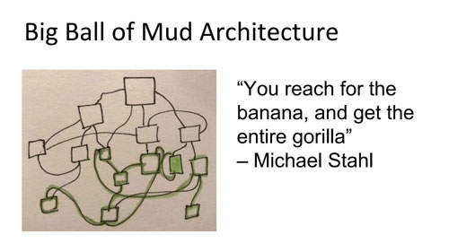
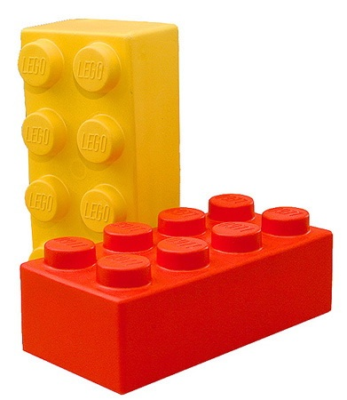
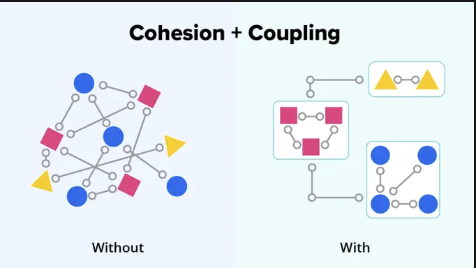
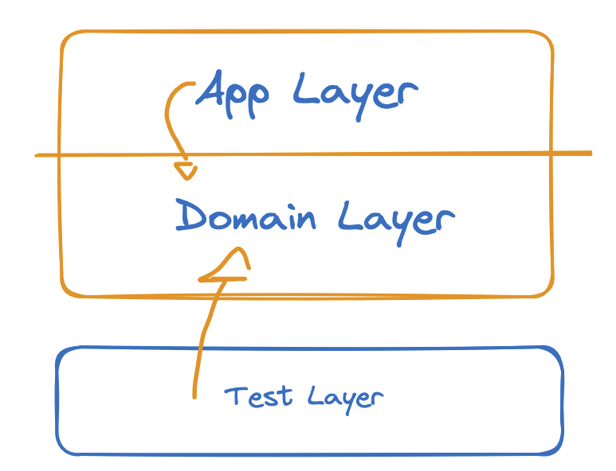

# Starship: Technical Background

# Teil A: Software Architecture (Design)

📖 Nachlesen: [Hayim Makabee, Separation of Concerns, 2012](https://effectivesoftwaredesign.com/2012/02/05/separation-of-concerns/)

## 1. Warum Software Architecture (Design)?

> Architecture represents the significant design decisions that shape a system.

Stellt euch Starship als eine Klasse mit 1000 Zeilen vor: Station, Schiffe, Regeln, Ausgabe und Tests in einer Datei.

- **Hard to change**: 50 Felder, die jede Methode schreiben darf (shared mutable state). Jede Änderung hat Seiteneffekte in Methoden, die man nicht angefasst hat.
- **Blast Radius**: Alles sieht alles, also kann ein Fehler alles treffen. Hohe Kopplung (Coupling) heißt großer Schaden bei kleiner Änderung.
- **Hard to test**: Für eine Regel muss der Test 50 Felder in einen gültigen Zustand bringen, und die Methode tut fünf Dinge auf einmal. Nichts lässt sich isoliert prüfen.
- **Hard to reuse**: Eine Monster Klassse gibt es nur ganz. Wer ein Zimmer braucht, muss das Hochhaus mitnehmen, samt aller Leitungen (Abhängigkeiten).
- **Hard to read**: Zehn Aufgaben in einer Klasse, keine lässt sich in einem Satz nennen. Eine Klasse, die versucht alles zu tun, ist schwer zu verstehen.

Die Antwort auf alle fünf hat einen Namen: `Separation of Concerns`.  
Und das Gegenteil hat auch einen: `Big Ball of Mud`.



## 2. Separation of Concerns

> A complex problem is divided into distinct parts that can be analyzed and changed individually.  
> It is one of the most important principles in software design.

- **Methode**: tut *eine* Sache. `Dock` dockt an, `Refuel` tankt. Keine Methode macht beides.
- **Klasse**: hat *eine* Verantwortung. `SpaceStation` verwaltet Crews and Ships, `Logbook` sammelt Einträge.
- **Layer**: hat *eine* Concern. `Domain` modelliert die Regeln, `App` erzählt die Story auf der Konsole, `Tests` prüfen die Regeln.



<sub style="margin-left: 100px; margin-top: 16px">Quelle: Hayim Makabee, Separation of Concerns, effectivesoftwaredesign.com, 2012</sub>

## 3. Cohesion und Coupling

Jede Ebene zieht eine Grenze. Ob die Grenze gut gezogen ist, misst man mit zwei Begriffen: Cohesion und Coupling.

- **Cohesion**: Wie sehr gehört zusammen, was in einer Klasse oder Schicht steckt. Hoch ist gut. `Logbook` macht nur Logbuch.
- **Coupling**: Wie viele andere Teile kennt ein Teil. Niedrig ist gut. `Domain` kennt niemanden, `App` kennt nur `Domain`.



## 4. Benefits of Good Architecture (Design)

Was gutes Design bringt, sind drei Eigenschaften.

- **Maintainability**: Eine Änderung bleibt in ihrem Modul. Eine Logbook-Änderung berührt nur `Logbook`, nicht `SpaceStation` oder `CargoShip`.
- **Extensibility**: Ein neuer Schiffstyp ist eine neue Subklasse von `BaseShip`. Alles andere bleibt unverändert, weil die Regeln in der Basis stehen.
- **Reusability**: `StarShip.Domain` hat keine Referenz nach außen. Deshalb kann es jede Anwendung benutzen: die Konsole heute, die Web API morgen.

## 5. Unsere Separation of Concerns

Drei Schichten, drei Projekte, eine Solution.

- **Domain Layer** (`StarShip.Domain`): das Domänenmodell, Schiffe, Station, Regeln. Kennt weder Konsole noch Tests.
- **App Layer** (`StarShip.App`): `Program.cs`, erzählt die Story auf der Konsole. Benutzt die Domäne.
- **Test Layer** (`StarShip.Tests`): prüft die Regeln der Domäne direkt, ohne Konsole.



## 6. C# Projekte und Solution

In .NET ist jede Schicht ein eigenes Projekt, und alle Projekte zusammen bilden eine Solution. So wird Separation of Concerns sichtbar: eine Zuständigkeit, ein Projekt.

- **Solution** (`StarShip.sln`): das Ganze. Eine Datei, die sagt, welche Projekte zusammengehören. Rider öffnet immer die Solution, nie ein einzelnes Projekt.
- **Projekt** (`*.csproj`): ein Ordner mit Code, der zu einer Einheit kompiliert wird. Die csproj Datei sagt, welches .NET, welche Pakete und welche Referenzen.

Projekte in einer Solution:

- **Class Library** (`StarShip.Domain`): ein Projekt ohne `Main`, nur Klassen. Es kann nicht gestartet werden, nur benutzt. Genau richtig für die Domäne.
- **Console Application** (`StarShip.App`): ein Projekt mit `Program.cs` und `Main`. Das ist, was `dotnet run` startet.
- **Unit Test Project** (`StarShip.Tests`): ein Projekt, das xUnit kennt. Jede Methode mit `[Fact]` ist ein Test, den Rider und `dotnet test` finden und ausführen.
- **Dependency Rule**: App und Tests referenzieren Domain, Domain referenziert nichts. So wird die Dependency Rule zum Compilerfehler, wenn jemand sie bricht.


---

# Teil B: Class Design

## 7. Abschnitte einer Klasse

Jede Klasse ist gleich aufgebaut, Abschnitte ohne Inhalt lasst ihr weg.

```csharp
public class SpaceStation : BaseEntity
{
    // --- Constants ---
    public const int MaxDocks = 10;

    // --- Fields ---
    private readonly List<BaseShip> _ships = [];

    // --- Props ---
    public int FuelPool { get; private set; }

    // --- Computed Properties (Queries) ---
    public IReadOnlyList<BaseShip> Ships => _ships.AsReadOnly();
    public int ShipCount => _ships.Count;

    // --- Constructor ---
    public SpaceStation(string name, Coordinate position) : base(name, position) { }

    // --- Business Methods ---
    public void Supply(int amount) { ... }

    // --- Helpers ---
    private bool HasFreeDock() => _ships.Count < MaxDocks;
}
```

- **Constants**: Werte, die für alle Objekte gleich sind.
- **Fields**: private Speicher, meist Listen. Nie public.
- **Props**: gespeicherte Werte, die man von außen lesen darf.
- **Queries**: alles mit `=>`. Speichert nichts, rechnet bei jedem Zugriff. Auch die Lesesichten auf Listen.
- **Constructor**: erzeugt das Objekt und prüft die Parameter.
- **Business Methods**: ändern den Zustand nach Regeln und schreiben ins Logbuch.
- **Equality**: sagt, wann zwei Objekte gleich sind. Nur in `BaseEntity`.
- **Helpers**: private Hilfsmethoden, die eine Businessmethode lesbar machen.

## 8. Constants

Eine Konstante ist ein fixer Wert, der für die ganze Klasse (und alle Instanzen) gilt.

```csharp
public const int MaxFuel = 10;

private static readonly IReadOnlyDictionary<CrewRole, int> Roles =
    new Dictionary<CrewRole, int> { [CrewRole.Captain] = 1, [CrewRole.Pilot] = 1 };
```

- **const**: ein fixer Wert, der für die ganze Klasse gilt (z.B. `int`, `double`, `string`).
- **static readonly**: ein fixes Objekt, das für die ganze Klasse gilt (z.B. `List`, `Dictionary`)

## 9. Backing Fields

Ein Backing Field ist ein privater Speicher, auf den ein Property oder Computed Property zugreift.

```csharp
public List<CrewMember> Crew { get; } = [];                      // so nicht: jeder kann Add aufrufen
```

```csharp
private readonly List<CrewMember> _crew = [];                    // Backing Field
public IReadOnlyList<CrewMember> Crew => _crew.AsReadOnly();     // Computed Property
```

- **readonly**: die Referenz ist nach dem Konstruktor fix. Der Inhalt der Liste darf sich trotzdem ändern.

## 10. Properties

Eine Property speichert einen Wert. Von außen darf man ihn lesen, nie schreiben. Welche Form sie hat, entscheidet eine Frage: Ändert sich der Wert nach dem Erzeugen?

```csharp
public string Name { get; init; }         // ändert sich nie: init
public int Fuel { get; private set; }     // ändert sich durch eine Businessmethode: private set
public Logbook Logbook { get; }           // entsteht im Konstruktor, kein Object Initializer: get
```

- **Kein public set**: bei uns gibt es keine Property, die von außen geschrieben wird. Zustand ändert sich nur über Businessmethoden.
- **Keine Prüfung in der Property**: eine Property hat keinen Guard und keine Regel. Prüfen passiert im Konstruktor und in Businessmethoden, warum steht in 14.
- **Die Frage**: nie ändern heißt `init`, ändern heißt `private set`, im Konstruktor erzeugt und nie ersetzt heißt `get`.

## 11. Computed Properties (Queries)

Was sich aus anderen Werten ausrechnen lässt, wird nie gespeichert.

```csharp
public int CrewCount => _crew.Count;
public bool IsDocked => Station is not null;
public IReadOnlyList<CrewMember> Crew => _crew.AsReadOnly();
```

## 12. Constructor

Der Konstruktor prüft nur seine Parameter, eine Zeile je Prüfung.

```csharp
public CrewMember(string name, CrewRole role)
{
    if (string.IsNullOrWhiteSpace(name)) throw new ArgumentException("Name fehlt", nameof(name));   // so kennt ihr es
    ...
}
```

```csharp
public CrewMember(string name, CrewRole role)
{
    // Guard: name must not be empty
    ArgumentException.ThrowIfNullOrWhiteSpace(name);

    Name = name.Trim();
    Role = role;
}
```

- **Nur Guards**: der Konstruktor prüft Parameter, keine Situation. So kann er nie an einer Regel scheitern.
- **Helfer**: `ThrowIfNull`, `ThrowIfNullOrWhiteSpace`, `ThrowIfNegativeOrZero`, `ThrowIfGreaterThan`. Sie werfen die passende `ArgumentException` und nennen den Parameter selbst.
- **protected**: `BaseEntity` und `BaseShip` haben einen `protected` Konstruktor, nur die Kindklassen rufen ihn.

## 13. Business Methods

Jede Businessmethode hat meistens drei Abschnitte: Guard, Business Rule und Business Logic. Bei uns noch der Audit Log, damit man später weiß, was in der Software passiert ist.

```csharp
public void AddCrew(CrewMember member)
{
    // Guard: member not null
    ArgumentNullException.ThrowIfNull(member);

    // Business Rule: not in the pool yet
    Rules.Require(!_crewPool.Contains(member), $"{member.Name} ist schon im Pool von {Name}.");

    // Business Logic: add to the pool
    _crewPool.Add(member);

    // Audit Log
    Logbook.Add(LogType.Crew, $"{member} im Pool");
}
```

- **Guard**: Sind die Parameter gültig? Wenn nicht, hat der Aufrufer einen Fehler gemacht, `ArgumentException`.
- **Business Rule**: Ist der Aufruf im Kontext unserer Regeln erlaubt? Wenn nicht, `StarshipException` mit Meldung.
- **Business Logic**: Die eigentliche Arbeit, eine Zeile oder mehrere. Erst hier ändert sich der Zustand.
- **Audit Log**: Ein Eintrag ins Logbuch, damit man später weiß, was in der Software passiert ist.


## 14. Business Methods: Warum kein public Setter

Deshalb gibt es keinen public Setter und keine Prüfung in der Property: Ein Setter sieht nur den neuen Wert, eine Businessmethode sieht die ganze Situation.

```csharp
xhosa.Fuel = 10;        // Setter: wer prüft, ob die Xhosa angedockt ist, ob der Pool reicht, wer schreibt ins Logbuch?
ds9.Refuel(xhosa);      // Businessmethode: Guard, Regeln, Logik und Logbuch an einer Stelle
```

- **Kontext**: `Refuel` kennt Station, Pool und Schiff. Ein Setter auf `Fuel` kennt nur `value`.
- **Ein Ort**: die Regel „nur im Dock tanken" steht in `Refuel`, nicht verteilt auf Setter und Aufrufer.
- **Logbuch**: ein Setter loggt nichts. Jede Änderung über eine Methode hinterlässt eine Spur.

## 15. Business Methods: Guards und Rules

Ein Guard prüft den Parameter, eine Business Rule prüft die Situation. Zwei Prüfungen, zwei Exceptions, zwei Schuldige.

```csharp
// Guard: der Aufrufer hat einen Fehler gemacht, daher `ArgumentException`
ArgumentNullException.ThrowIfNull(member);
ArgumentException.ThrowIfNullOrWhiteSpace(name);
ArgumentOutOfRangeException.ThrowIfNegativeOrZero(tons);
ArgumentOutOfRangeException.ThrowIfGreaterThan(requiredRoles.Values.Sum(), MaxCrew);

// Business Rule: die Situation erlaubt es nicht, daher eigene Exception `StarshipException`
Rules.Require(IsDocked, $"{Name} ist nicht angedockt.");
Rules.Require(Cargo + tons <= MaxCargo, $"{Name} fasst nur {MaxCargo} t, geladen {Cargo} t.");
```

- **Guard**: der Parameter ist ungültig, das ist ein Programmierfehler. `ArgumentException` mit den `ThrowIf` Helfern, ohne eigene Meldung.
- **Business Rule**: der Parameter ist in Ordnung, aber der Zustand verbietet es. `StarshipException` mit einer Meldung, die der Captain versteht.

Eine Regel ist eine Zeile mit `Rules.Require`, nicht `if` und `throw`.

```csharp
if (ShipCount >= MaxDocks)
    throw new StarshipException("Kein Pylon frei.");        // so kennt ihr es

Rules.Require(ShipCount < MaxDocks, "Kein Pylon frei.");    // so schreiben wir es in StarShip
```

- **Rules.Require**: ist die Bedingung falsch, wirft es die `StarshipException` mit der Meldung.

## 16. Helpers

Ein Helper macht eine Businessmethode kürzer und ist von außen unsichtbar.

```csharp
// --- Helpers ---

private Coordinate NextPosition(Coordinate target)
{
    double distance = DistanceTo(target);
    return distance <= WarpRange ? target : StepToward(target, WarpRange / distance);
}
```

- **private**: niemand außerhalb der Klasse ruft einen Helper.

## 17. Entity und Value Object

Alles in Shared ist ein Value Object, Station und Schiffe sind Entities.

```csharp
public record Coordinate(int X, int Y);          // Value Object

public class CargoShip : BaseShip { ... }        // Entity
```

- **Value Object**: nur Werte, keine `Id`, unveränderlich. Zwei mit gleichen Werten sind gleich. Immer ein `record`.
- **Entity**: hat eine `Id` und einen Lebenslauf. Sie ändert sich über Businessmethoden, bleibt aber dasselbe Ding. Immer eine `class`.

## 18. Beziehungen: Richtung und Anzahl

Jede Beziehung hat eine Anzahl und eine Navigationsrichtung. Beides entscheidet ihr beim Modell, nicht beim Programmieren.

```csharp
public Logbook Logbook { get; }                       // BaseEntity -> Logbook: 1:1, bidirektional
public BaseEntity Owner { get; }                      // Logbook -> BaseEntity: der Weg zurück

public IReadOnlyList<BaseShip> Ships => ...;          // SpaceStation -> BaseShip: 1:n, bidirektional
public SpaceStation? Station { get; private set; }    // BaseShip -> SpaceStation: der Weg zurück

public IReadOnlyList<CrewMember> Crew => ...;         // BaseShip -> CrewMember: 1:n, unidirektional
```

- **1:1**: zu einem Objekt gehört genau ein anderes, im Code ein Verweis. Ein Schiff hat genau ein Logbuch.
- **1:n**: zu einem Objekt gehören viele andere, im Code eine Liste. Eine Station hat viele Schiffe.
- **Uni**: Navigation in eine Richtung, nur eine Seite verweist auf die andere.
- **Bi**: Navigation in beide Richtungen, beide Seiten verweisen aufeinander, nur wenn der Rückweg gebraucht wird.

## 19. Beziehungen pflegen: der Parent setzt beide Seiten

Bei einer Beziehung gibt es einen Parent und ein Child. Der Parent ist der fachliche Owner, das Child gehört zu ihm: ein Logbuch zu seiner Entity, ein Schiff zu seiner Station.  
Der Parent setzt die Beziehung, bei uni eine Seite, bei bi beide, in einer Methode und in fester Reihenfolge.

```csharp
Logbook = new Logbook(this);     // 1:1 in BaseEntity: einmal im Konstruktor, nie wieder

public void Dock(BaseShip ship)  // 1:n in SpaceStation
{
    // ... Guard und Regeln
    _ships.Add(ship);            // Parent-Seite zuerst
    ship.AttachTo(this);         // dann die Child-Seite
}
```

- **Parent (Owner)**: Der Parent ist der fachliche Owner. Andocken heißt `ds9.Dock(xhosa)`, nie `xhosa.AttachTo(ds9)`. Nur `Dock` kennt die Reihenfolge und loggt.
- **Child (Dependent)**: `AttachTo` muss public sein, `Dock` ruft es von außen. Deshalb prüft das Child, ob der Owner ruft: Das Schiff muss schon in `station.Ships` stehen, sonst `StarshipException`.
- **Komposition**: Das Child entsteht im Konstruktor des Parents. `Logbook = new Logbook(this)`, einmal, nie getauscht.
- **Aggregation**: Das Child kommt und geht über Methoden. `Dock` setzt `Station`, `Undock` setzt `null`, deshalb nullable.

## 20. Tests

Jeder Test heißt `Sut_ShouldXxx_WhenXxx`: Was wird getestet, was soll passieren, unter welcher Bedingung.

```csharp
Refuel_ShouldFillWarpCore_WhenStationHasEnoughFuel
Dock_ShouldThrow_WhenShipIsAlreadyDocked
Status_ShouldBeInSpace_WhenShipHasNoStation
AssignCrew_ShouldBoardCaptainAndPilot_WhenPoolHasBoth
```

- **Sut**: System under Test, die Methode oder Query, die ihr aufruft: `Refuel`, `Dock`, `Status`.
- **ShouldXxx**: das erwartete Ergebnis, `FillWarpCore`, `Throw`, `BeInSpace`. Das steht im Then.
- **WhenXxx**: die Ausgangslage, `StationHasEnoughFuel`, `ShipIsAlreadyDocked`. Das baut das Given.

Jeder Test hat drei Teile: Given, When, Then.

```csharp
[Fact]
public void Refuel_ShouldFillWarpCore_WhenStationHasEnoughFuel()       // Positivtest
{
    // Given
    var ds9 = new SpaceStation("Deep Space 9", Home);
    var xhosa = new CargoShip("Xhosa", Home, 100);
    ds9.Supply(40);
    ds9.Dock(xhosa);

    // When
    ds9.Refuel(xhosa);

    // Then
    Assert.Equal(BaseShip.MaxFuel, xhosa.Fuel);
    Assert.Equal(30, ds9.FuelPool);
}
```

```csharp
[Fact]
public void Dock_ShouldThrow_WhenShipIsAlreadyDocked()                 // Negativtest
{
    // Given
    var ds9 = new SpaceStation("Deep Space 9", Home);
    var xhosa = new CargoShip("Xhosa", Home, 100);
    ds9.Dock(xhosa);

    // When / Then
    Assert.Throws<StarshipException>(() => ds9.Dock(xhosa));
}
```

- **Positivtest**: die Methode tut, was sie soll. Then prüft den neuen Zustand.
- **Negativtest**: eine Regel greift. `Assert.Throws` führt den Aufruf selbst aus, When und Then fallen zusammen.

---

# Teil C: C# Techniken

Jedes Kapitel zeigt zuerst **Vorher** (so kennt ihr es) und dann **Nachher** (so schreiben wir es).

## 21. Auto Properties

Der Compiler schreibt das Backing Field, ihr schreibt nur das Wort, das sagt, wer schreiben darf und wann.

```csharp
public int Fuel { get; set; }              // jeder, jederzeit
public int Fuel { get; private set; }      // nur die Klasse, jederzeit
public string Name { get; init; }          // jeder, aber nur beim Erzeugen
public Logbook Logbook { get; }            // nur der Konstruktor
public int CrewCount => _crew.Count;       // niemand, wird berechnet
```

- **get; set**: jeder darf schreiben, auch von außen. Gibt es bei uns nicht, kommt später bei DTOs im Web-Teil.
- **get; private set**: nur Methoden derselben Klasse schreiben, dafür jederzeit. `Fuel`, `Cargo`, `Position`.
- **get; init**: jeder darf schreiben, aber nur im Konstruktor oder im Object Initializer direkt hinter `new`. Danach ist zu. `Name`, `Id`, `BuiltAt`.
- **get**: nur der Konstruktor, nicht einmal der Object Initializer. `Logbook`, `Owner`.
- **=>**: kein Backing Field, kein Speicher, bei jedem Zugriff berechnet. `CrewCount`, `Status`.

Und wer setzt den Wert wann? Es gibt vier Stellen, und jede Property hat genau eine davon.

```csharp
public Guid Id { get; init; } = Guid.CreateVersion7();       // 1. direkt in der Deklaration
public string Name { get; init; }                            // 2. im Konstruktor, nach dem Guard: Name = name.Trim();
public Logbook Logbook { get; }                              // 2. im Konstruktor: Logbook = new Logbook(this);
public int Fuel { get; private set; }                        // 4. in einer Businessmethode: Fuel += amount;

var xhosa = new CargoShip("Xhosa", home, 100) { BuiltAt = new DateOnly(2360, 5, 12) };   // 3. Object Initializer
```

- **Direkt**: `= ...` hinter der Property läuft vor dem Konstruktor. Für Werte, die keinen Parameter brauchen: `Id`, `BuiltAt`, leere Listen.
- **Konstruktor**: alles, was aus einem Parameter kommt oder geprüft wird. Eine `{ get; }` Property kann nur hier gesetzt werden.
- **Object Initializer**: `{ BuiltAt = ... }` direkt hinter `new` überschreibt den direkten Wert. Geht nur bei `init` und `set`, danach ist `init` für immer zu. Was sich später ändert, hat `private set` und wird nur in Businessmethoden gesetzt.

## 22. Records

Ein Typ, der nur aus Werten besteht, braucht Konstruktor, Gleichheit und `ToString`. Das sind 12 Zeilen, die immer gleich aussehen.

**Vorher** (so kennt ihr es)
```csharp
public class Coordinate : IEquatable<Coordinate>
{
    public int X { get; init; }
    public int Y { get; init; }

    public Coordinate(int x, int y) { X = x; Y = y; }

    public bool Equals(Coordinate? other) => other is not null && other.X == X && other.Y == Y;
    public override bool Equals(object? obj) => Equals(obj as Coordinate);
    public override int GetHashCode() => HashCode.Combine(X, Y);
    public override string ToString() => $"Coordinate {{ X = {X}, Y = {Y} }}";
}
```

**Nachher** (so schreiben wir es)
```csharp
public record Coordinate(int X, int Y);                       // Positional Record, eine Zeile

public record CrewMember                                      // Record mit eigenem Konstruktor
{
    public string Name { get; init; }
    public CrewRole Role { get; init; }

    public CrewMember(string name, CrewRole role)
    {
        ArgumentException.ThrowIfNullOrWhiteSpace(name);
        Name = name.Trim();
        Role = role;
    }
}
```

- **Record**: der Compiler schreibt Konstruktor, `Equals`, `GetHashCode` und `ToString`. Zwei Records mit gleichen Werten sind gleich.
- **Positional Record**: Props und Konstruktor aus der Klammer. Nehmt ihn, wenn es nichts zu prüfen gibt.
- **Eigener Konstruktor**: sobald ein Wert geprüft oder getrimmt wird. `CrewMember`, `DistressSignal`.

## 23. Equality

Wann sind zwei Objekte gleich? Ein Record nach seinen Werten, eine Entity nach ihrer Id. Ohne eure Hilfe vergleicht C# nur die Adresse im Speicher.

**Vorher** (so kennt ihr es)
```csharp
public class Coordinate { ... }                              // Coordinate als Klasse
new Coordinate(3, 4).Equals(new Coordinate(3, 4));           // false, zwei Adressen, obwohl die Werte gleich sind

var a = new CargoShip("Xhosa", home, 100);
var b = new CargoShip("Kopie", home, 50) { Id = a.Id };      // dieselbe Id, also dasselbe Schiff
a.Equals(b);                                                 // false, zwei Adressen
_ships.Contains(b);                                          // false, die Xhosa dockt ein zweites Mal an
```

**Nachher** (so schreiben wir es)
```csharp
public record Coordinate(int X, int Y);                      // Record: der Compiler schreibt Equals nach den Werten
new Coordinate(3, 4).Equals(new Coordinate(3, 4));           // true

public abstract class BaseEntity : IEquatable<BaseEntity>    // Entity: ihr schreibt Equals nach Typ und Id
{
    public bool Equals(BaseEntity? other) =>
        other is not null && other.GetType() == GetType() && other.Id == Id;

    public override bool Equals(object? obj) => Equals(obj as BaseEntity);

    public override int GetHashCode() => Id.GetHashCode();
}
a.Equals(b);                                                 // true
_ships.Contains(b);                                          // true, Dock lehnt die Kopie ab
```

- **Record**: gleiche Werte, gleiches Objekt. Zwei Koordinaten (3,4) sind derselbe Punkt im All.
- **Entity**: gleicher Typ und gleiche `Id`. Zwei Frachter namens Xhosa sind zwei Schiffe. `Equals(BaseEntity?)` ist die typsichere Fassung, `Equals(object?)` leitet dorthin weiter.
- **GetHashCode**: wer `Equals` überschreibt, muss auch den Hash überschreiben, sonst verhalten sich `HashSet` und `Dictionary` falsch. Der Hash darf sich nie ändern, deshalb ist `Id` `init`.

## 24. Operator Overloading

`Equals` ist überschrieben, aber `a == b` sagt immer noch „nicht gleich". Für `==` und `!=` muss die Klasse die Operatoren selbst festlegen.

**Vorher** (so kennt ihr es)
```csharp
a.Equals(b);                                                 // true
a == b;                                                      // false, == vergleicht immer noch die Adresse
```

**Nachher** (so schreiben wir es)
```csharp
public static bool operator ==(BaseEntity? left, BaseEntity? right) =>
    left is null ? right is null : left.Equals(right);

public static bool operator !=(BaseEntity? left, BaseEntity? right) => 
    !(left == right);

a == b;                                                      // true
new Coordinate(3, 4) == new Coordinate(3, 4);                // true, beim Record schreibt das der Compiler
```

- **Paar**: `==` und `!=` gibt es nur zusammen, der Compiler verlangt beide.
- **null**: beide müssen `null` auf beiden Seiten vertragen, deshalb die Prüfung mit `is null` vor `Equals`.
- **Record**: bekommt `==` und `!=` geschenkt, genau wie `Equals`. Nur eine Klasse muss sie selbst schreiben.

## 25. Primary Constructor

Ein Konstruktor, der nur weiterreicht, ist drei Zeilen für nichts. Seit C# 12 dürfen die Parameter direkt am Klassennamen stehen.

**Vorher** (so kennt ihr es)
```csharp
public class StarshipException : Exception
{
    public StarshipException(string message) : base(message)
    {
    }
}
```

**Nachher** (so schreiben wir es)
```csharp
public class StarshipException(string message) : Exception(message);   // Primary Constructor, kein Rumpf nötig
```

- **Kurz**: Parameter am Klassennamen, der Aufruf der Basis gleich dahinter. Die Parameter gelten in der ganzen Klasse.
- **Kein Platz für Guards**: ein Primary Constructor hat keinen Rumpf. Prüfen und Trimmen geht nicht, `BaseEntity` und `CargoShip` brauchen deshalb den ausgeschriebenen Konstruktor.
- **Wo er passt**: überall, wo nur weitergereicht wird. Bei uns nur `StarshipException`. `SpaceStation` und `RescueShip` könnten ihn auch, behalten aber die lange Form, damit alle Entities gleich aussehen.

## 26. Pattern Matching

Typ prüfen und dann casten, zwei Bedingungen mit `&&` verknüpfen, `!= null` schreiben: Das geht in einer Frage mit `is`.

**Vorher** (so kennt ihr es)
```csharp
if (ship is CargoShip) { var cargo = (CargoShip)ship; ... }      // prüfen und dann casten
if (ship.Station == null && ship.Fuel < MaxFuel) ...             // zwei Bedingungen
if (xhosa.Distress != null) ...
```

**Nachher** (so schreiben wir es)
```csharp
if (ship is CargoShip cargo)                    // Typ-Pattern mit Variable
if (ship is { Station: null, Fuel: < MaxFuel }) // Property Pattern und relationales Pattern
if (ship is CargoShip { IsFull: true } full)    // Typ und Property zusammen
if (xhosa.Distress is not null)                 // null-Pattern
```

- **Typ-Pattern**: prüft den Typ und gibt gleich die Variable mit. Kein Cast nötig.
- **Property Pattern**: prüft Properties in geschweiften Klammern, mehrere mit Komma.
- **Relationales Pattern**: `<`, `<=`, `>`, `>=` gegen einen konstanten Wert. Deshalb muss `MaxFuel` eine `const` sein.

## 27. Von `if` zur Switch Expression

Eine Methode mit drei `return`, nur um einen Wert auszuwählen. Das geht als ein Ausdruck.

**Vorher** (so kennt ihr es)
```csharp
public ShipStatus GetStatus()                                        // mit if
{
    if (Distress is not null) return ShipStatus.Distress;
    if (Station is null) return ShipStatus.InSpace;
    return ShipStatus.Docked;
}

switch (Fuel)                                                        // klassisches switch, nur Konstanten
{
    case 0: return Readiness.NeedsFuel;
    default: return Readiness.Ready;
}
```

**Nachher** (so schreiben wir es)
```csharp
public ShipStatus Status => this switch                              // Switch Expression mit Patterns
{
    { Distress: not null } => ShipStatus.Distress,
    { Station: null }      => ShipStatus.InSpace,
    _                      => ShipStatus.Docked
};
```

- **Expression**: liefert einen Wert, deshalb passt sie hinter `=>` in eine Query.
- **Reihenfolge**: die erste passende Zeile gewinnt. Das Wichtigste steht oben, `_` fängt den Rest.
- **this switch**: das Objekt selbst wird gegen die Patterns aus Kapitel 26 geprüft.

## 28. Extension Methods

Eine Frage an die ganze Flotte gehört zu keiner Entity. Sie landet in einer statischen Hilfsklasse, und der Aufruf liest sich wie ein Werkzeug, nicht wie eine Frage an die Liste.

**Vorher** (so kennt ihr es)
```csharp
public static class ShipQueries
{
    public static IReadOnlyList<BaseShip> InSpace(IEnumerable<BaseShip> ships) =>
        ships.Where(s => s.Status == ShipStatus.InSpace).ToList();
}

var inSpace = ShipQueries.InSpace(fleet);     // die Liste wird übergeben
```

**Nachher** (so schreiben wir es)
```csharp
public static class ShipQueries
{
    public static IReadOnlyList<BaseShip> InSpace(this IEnumerable<BaseShip> ships) =>
        ships.Where(s => s.Status == ShipStatus.InSpace).ToList();
}

var inSpace = fleet.InSpace();                // die Liste steht links vom Punkt
```

- **this**: ein Wort Unterschied. Das `this` vor dem ersten Parameter erlaubt den Aufruf auf der Liste, als wäre die Methode eingebaut. Der Compiler macht daraus wieder `ShipQueries.InSpace(fleet)`.
- **static**: Klasse und Methode müssen `static` sein, und `Program.cs` braucht `using StarShip.Domain.Queries;`.
- **LINQ**: `Where`, `Count` und `MinBy` sind genau so gebaut, Extension Methods auf `IEnumerable<T>`. Deshalb lassen sie sich verketten: `fleet.InSpace().Select(s => s.Name)`.

## 29. `virtual`, `override` und `base`

Eine Basisklasse gibt ein Verhalten vor, das ein Kind ändern darf. Drei Wörter: `virtual` erlaubt es, `override` macht es, `base` nutzt das Original.

**Das kennt ihr schon**: `ToString` ist in `object` als `virtual` deklariert, ihr habt es in `Coordinate` überschrieben.

```csharp
// in object, von Microsoft geschrieben: die Basis erlaubt das Ändern
public virtual string ToString() => GetType().Name;

// in Coordinate, von euch geschrieben: das Kind ändert es
public override string ToString() => $"({X},{Y}) Lichtjahre";
```

**So schreiben wir es**: bei `Report` und `Scan` schreibt ihr beide Seiten selbst. Das Kind schreibt nur den Unterschied, den Rest holt es mit `base`.

```csharp
// BaseShip: die Basis gibt den Report vor und erlaubt das Ändern
public virtual string Report() => ...;

// CargoShip: das Kind erweitert, der Report der Basis plus eine Zeile Cargo
public override string Report() =>
    base.Report() + Environment.NewLine + $"  {"Cargo",-12}{Cargo}/{MaxCargo} t ({CargoPercent} %)";

// RescueShip: das Kind filtert, der Scan der Basis, aber nur Schiffe in Not
public override IEnumerable<BaseShip> Scan(IEnumerable<BaseShip> ships) =>
    base.Scan(ships).Where(s => s.Status == ShipStatus.Distress);
```

- **virtual**: steht in der Basis und heißt „ein Kind darf das anders machen". Ohne `virtual` ist die Methode für alle gleich.
- **override**: steht im Kind, gleiche Signatur, ersetzt die Fassung der Basis. Wer ein `BaseShip` in der Hand hat und `Report()` ruft, bekommt trotzdem die Fassung des Frachters.
- **base**: ruft die Fassung der Basis aus dem Kind heraus. `CargoShip` hängt an, `RescueShip` filtert.

## 30. Nullable

`xhosa.Station.Name` läuft durch den Compiler und crasht im All, wenn das Schiff gerade nicht angedockt ist.

**Vorher** (so kennt ihr es)
```xml
<Nullable>disable</Nullable>
```
```csharp
public SpaceStation Station { get; private set; }         // darf null sein, sagt aber niemand
Console.WriteLine(xhosa.Station.Name);                    // NullReferenceException beim Kunden
```

**Nachher** (so schreiben wir es)
```xml
<Nullable>enable</Nullable>
<WarningsAsErrors>nullable</WarningsAsErrors>
```
```csharp
public SpaceStation? Station { get; private set; }       // ? heißt: darf null sein
public bool IsDocked => Station is not null;              // prüfen
Console.WriteLine(xhosa.Station.Name);                    // error CS8602: Dereference of a possibly null reference
Console.WriteLine(xhosa.Distress?.Reason);                // ?. liest nur, wenn nicht null
var station = Station ?? throw new StarshipException($"{Name} ist nicht angedockt.");   // holen oder werfen
```

- **Compile-time**: `SpaceStation` ist nie `null`, `SpaceStation?` darf es sein. Jeder Zugriff wird beim Bauen geprüft, nicht beim Kunden.
- **Fehler statt Warnung**: `WarningsAsErrors` macht aus jeder möglichen `NullReferenceException` einen Build-Fehler.
- **`?.` und `?? throw`**: `?.` greift nur zu, wenn nicht `null`. `?? throw` holt den Wert oder wirft, danach ist der Wert sicher nicht `null`.

## 31. Strings

Text mit `+` zusammenkleben, `\n` für Zeilen und `PadRight` für Spalten: Das liest niemand gern.

**Vorher** (so kennt ihr es)
```csharp
"Warp-Sprung nach " + Position + ", Antimaterie " + Fuel + "/" + MaxFuel

Name + " (" + GetType().Name + ")\n" +
"  " + "Status".PadRight(12) + Status + "\n" +
"  " + "Fuel".PadRight(12) + Fuel + "/" + MaxFuel
```

**Nachher** (so schreiben wir es)
```csharp
$"Warp-Sprung nach {Position}, Antimaterie {Fuel}/{MaxFuel}"                  // Interpolation

$"""
{Name} ({GetType().Name})
  {"Status",-12}{Status}
  {"Fuel",-12}{Fuel}/{MaxFuel}
"""                                                                           // Raw String Literal
```

- **Interpolation**: `$"..."` setzt Werte in geschweiften Klammern ein. `{Position}` ruft `ToString()` auf.
- **Raw String Literal**: `$"""..."""` über mehrere Zeilen, keine `\n`, die gemeinsame Einrückung wird entfernt.
- **Linksbündig**: `{"Status",-12}` füllt rechts mit Leerzeichen auf 12 Zeichen auf, `Status      `. Das Minus heißt links, so entstehen die Spalten im Report.
- **Rechtsbündig**: `{Fuel,3}` füllt links auf, `  7`. Ohne Minus heißt rechts, so stehen Zahlen untereinander. `{SentAt:HH:mm:ss}` formatiert eine Zeit.

## 32. Factory Method

Ein Konstruktor mit einem Enum-Parameter liest sich schlecht und lässt sich leicht vertippen. Eine statische Methode mit sprechendem Namen nimmt die Entscheidung ab.

**Vorher** (so kennt ihr es)
```csharp
var kira = new CrewMember("Kira", CrewRole.Captain);
var nog  = new CrewMember("Nog", CrewRole.Pilot);
```

**Nachher** (so schreiben wir es)
```csharp
public static CrewMember Captain(string name) => new(name, CrewRole.Captain);
public static CrewMember Pilot(string name)   => new(name, CrewRole.Pilot);

var kira = CrewMember.Captain("Kira");
var nog  = CrewMember.Pilot("Nog");
```

- **static**: die Methode gehört zum Typ, nicht zu einem Objekt. Man ruft sie über den Typnamen auf, es gibt ja noch kein Objekt.
- **new(...)**: der Typ steht schon links im Rückgabetyp, deshalb darf er beim `new` wegbleiben (target-typed new).
- **Konstruktor bleibt**: die Factory ruft ihn auf, der Guard im Konstruktor gilt weiter. Die Factory wählt nur die Rolle.
